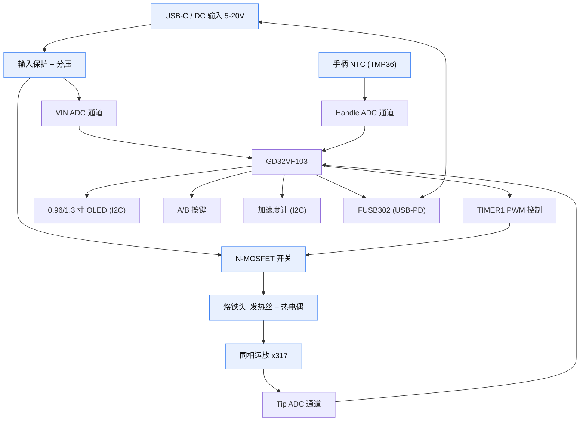

# IronOS 源码详解 00：总览与硬件架构

> 涉及文件：
> `source/Core/Src/main.cpp`、`source/Core/BSP/BSP.h`、`source/Core/BSP/Pinecil/BSP.cpp`、
> `source/Core/BSP/Pinecil/configuration.h`、`source/Core/BSP/Pinecil/Setup.cpp`、
> `source/Core/BSP/Pinecilv2/configuration.h`、`source/Core/Drivers/TipThermoModel.cpp`、
> `source/Core/Src/power.cpp`、`Makefile`

IronOS 是 Pinecil / TS100 / TS80 / MHP30 / Sequre 等便携电烙铁的开放固件。本系列以
**Pinecil V1（GD32VF103，RISC-V）** 为主线读码，同时标注 Pinecil V2（BL706）与
STM32F103 机型（TS100/TS80/MHP30）的差异。仓库版本为 `v2.23`（`source/version.h`）。

## 全景：目录与职责

| 路径 | 职责 | 级别 |
| --- | --- | --- |
| `source/Core/Src/` | 主程序、电源原语、设置、QC3、翻译访问器、设置菜单 | 自有核心 |
| `source/Core/Threads/` | 四个 FreeRTOS 任务：PID / POW / MOV / GUI | 自有核心 |
| `source/Core/Threads/UI/` | 各工作模式的逻辑（logic/）与绘制（drawing/） | 自有核心 |
| `source/Core/Drivers/` | OLED、按键、I2C、加速度计、USB-PD 胶水层、温度模型 | 自有驱动 |
| `source/Core/BSP/` | 板级支持：`Pinecil`、`Pinecilv2`、`Miniware`、`MHP30`、`Sequre` | 板级 |
| `source/Core/BSP/*/Vendor/` | 厂商 CMSIS/HAL（ST 等） | 第三方，不动 |
| `source/Core/Drivers/usb-pd/` | 独立 USB-PD 协议栈（FUSB302 + PolicyEngine） | 第三方，不动 |
| `source/Core/brieflz/`、`source/Middlewares/` | 压缩/中间件 | 第三方，不动 |
| `Translations/`、`source/Settings/` | 多语言与设置表的生成脚本/数据 | 生成物，不动 |

## 机型与关键差异

| 机型 | MCU | ADC 满量程 | Vref | 最大 PD 电压 | 备注 |
| --- | --- | --- | --- | --- | --- |
| Pinecil（V1） | GD32VF103（RISC-V，108 MHz） | `4096 * 8 = 32768` | 3300 mV | 20 V | 本文主线 |
| Pinecil V2 | BL706（RISC-V） | `(1 << 16) >> 1 = 32768` | 3200 mV | 28 V（EPR 140 W） | 16 位 ADC、BLE |
| TS100 / TS80(P) | STM32F103 | 4096×8 | 3300 mV | 无 PD | 走 Miniware BSP |
| MHP30 | STM32F103 | 4096×8 | 3300 mV | 无 PD | 加热板，需测电阻 |

Pinecil V1 的硬件常量集中在 `source/Core/BSP/Pinecil/BSP.cpp` 与 `configuration.h`：

```c
const uint16_t powerPWM         = 255;
const uint8_t  holdoffTicks     = 10;
const uint8_t  tempMeasureTicks = 14;
```

（`source/Core/BSP/Pinecil/BSP.cpp:16-18`）

这三个数定义了 PWM 周期的三段结构：**加热段 255 tick + 采样段 14 tick + 死区 10 tick**，
快模式下 `totalPWM = 255 + 14 + 10 = 279`，慢模式为 `255 + 7 + 5 = 267`
（`source/Core/BSP/Pinecil/IRQ.cpp` 的 `switchToFastPWM` / `switchToSlowPWM`）。

```c
#define OP_AMP_GAIN_STAGE_PINECIL (1 + (OP_AMP_Rf_Pinecil / OP_AMP_Rin_Pinecil))

#define ADC_MAX_READING (4096 * 8) // Maximum reading of the adc
#define ADC_VDD_MV      3300       // ADC max reading millivolts
```

（`source/Core/BSP/Pinecil/configuration.h:119-122`）

`OP_AMP_Rf_Pinecil = 750 * 1000`、`OP_AMP_Rin_Pinecil = 2370`，所以运放增益为
`1 + 750000/2370 ≈ 317.5`，代码里取整数 317。这个增益决定了"ADC 的 1 个计数"
对应热电偶多少微伏：

```
1 LSB = 3300 mV / 32768      = 0.1007 mV = 100.7 uV（运放输出端）
     = 100.7 uV / 317.5      ≈ 0.317 uV（热电偶端）
```

## 硬件拓扑

Pinecil 把"发热丝"和"热电偶"做在同一支烙铁头里，二者串联：加热时电流流过发热丝，
测温时必须先关断电流，否则测到的是加热电压而不是热电势。这就是固件里
"PWM 加热 + 固定采样窗口"分时复用的根本原因。



`powerPWM = 255` 不是随意取的：TIMER1 的计数时钟决定分辨率与频率的折中。以源码注释为准，
快模式约 10 Hz、慢模式约 5 Hz（`IRQ.cpp` 中 `switchToFastPWM` 注释写 `~10Hz`，
`switchToSlowPWM` 写 `5Hz`），也就是**控制周期 100 ms / 200 ms 量级**。
`PID_TIM_HZ` 在 Pinecil V1 上配成 8，与这个量级一致（`configuration.h:140`）。

## 信号链：从 ADC 到温度


对应代码在 `source/Core/Drivers/TipThermoModel.cpp`：

```cpp
uint32_t vddRailmVX10 = ADC_VDD_MV * 10; // The vreg is +-2%, but we have no higher accuracy available
// 4096 * 8 readings for full scale
// Convert the input ADC reading back into mV times 10 format.
uint32_t rawInputmVX10 = (rawADC * vddRailmVX10) / (ADC_MAX_READING);
```

（`source/Core/Drivers/TipThermoModel.cpp:58-63`）

先放大 10 倍再除，是为了在整数运算里保留 0.1 mV 精度；这也解释了为什么变量名都带 `X10`。

冷端补偿在 `getTipInC()` 里完成：

```cpp
TemperatureType_t currentTipTempInC = TipThermoModel::convertTipRawADCToDegC(getTipRawTemp(sampleNow));
currentTipTempInC += getHandleTemperature(sampleNow) / 10; // Add handle offset
```

（`source/Core/Drivers/TipThermoModel.cpp:119-120`）

热电偶测的是"热端相对冷端的温差"，手柄 NTC 测冷端，所以必须相加。忘记这一步的典型症状是：
**冬天开机显示温度偏低、夏天偏高**，而且校准温度点会随环境漂移。

## BSP 分层：一块板要提供什么

`source/Core/BSP/BSP.h` 是"移植契约"，纯 C 接口，共约 30 个函数。按职责分四组：

| 组 | 函数 | 说明 |
| --- | --- | --- |
| 生命周期 | `preRToSInit()` / `postRToSInit()` / `BSPInit()` / `reboot()` | 调度器前后各一次 |
| 加热与测温 | `setTipPWM()` / `getTipRawTemp()` / `getHandleTemperature()` / `getInputVoltageX10()` | 控制环的硬件半边 |
| 功率模型 | `getTipResistanceX10()` / `getTipThermalMass()` / `getTipInertia()` | 供 W↔PWM 换算 |
| 人机与外设 | `getButtonA/B()`、`setStatusLED()`、`setBuzzer()`、`getHallSensorFitted()` | 机型可选 |

```c
// Accepts a output level of 0.. to use to control the tip output PWM
void setTipPWM(const uint8_t pulse, const bool shouldUseFastModePWM);
```

（`source/Core/BSP/BSP.h:39-40`）

注意 `setTipPWM` 只接收"占空计数 + 快慢模式"，具体定时器寄存器操作由 BSP 实现。
Pinecil 把它拆成"写两个 volatile 变量"，真正的寄存器更新放在 TIMER1 中断里
（`source/Core/BSP/Pinecil/IRQ.cpp` 的 `setTipPWM`），这样占空总在周期边界生效。

## 一次加热周期里发生了什么

把 `Setup.cpp` 的定时器/ADC 配置与 `IRQ.cpp` 对照，可以得到下面这条时间线
（数值为计数器 tick，快模式）：

| 时刻 | 事件 | 代码位置 |
| --- | --- | --- |
| 0 | 周期开始，UP 中断：装载本周期占空到 TIMER1_CH1 | `IRQ.cpp` `TIMER1_IRQHandler` |
| 0..pulse | 加热段，MOSFET 导通 | 硬件 |
| pulse | CH1 比较匹配：强制 TIMER2 输出 0，加热结束 | `IRQ.cpp` `TIMER_INT_CH1` 分支 |
| 265 | CH0 比较匹配 → TRGO 触发 ADC 注入组（4 通道） | `Setup.cpp` `adc_external_trigger_source_config` |
| 265..279 | 采样窗口 14 tick，等待运放/ADC 稳定 | `tempMeasureTicks` |
| 279 | 周期结束；ADC EOIC 中断唤醒 PID 任务 | `ADC0_1_IRQHandler` |

这解释了为什么"占空不能到 100%"：`powerPWM/totalPWM = 255/279 ≈ 91.4%`，
`availableW10()` 里正是用这个比例折算可用功率（`source/Core/Src/power.cpp:96-97`）。

## 量化：一根 Pinecil 烙铁头的功率上限

```
R_tip = 7.5 Ω（TIP_RESISTANCE = 75，单位 0.1 Ω）
V_max = 20 V（USB_PD_VMAX）
P_ideal = V^2 / R = 400 / 7.5 = 53.3 W
P_usable = 53.3 * 255/279 ≈ 48.7 W
```

但 `HARDWARE_MAX_WATTAGE_X10 = 750`，即 75 W 的硬件上限（`configuration.h:169`），
所以瓶颈在电源与烙铁头，不在输出级。`TIP_THERMAL_MASS = 65`（x10 J/°C）意味着
把烙铁头从 25 °C 加热到 320 °C 理论上需要 `65/10 * 295 ≈ 1917 J`，
在 48 W 下约 **40 s**（实际因散热与效率会更久，这也是"开机要等"的物理原因）。

## 多板型 BSP 的差异点

| 差异 | Pinecil V1 | Pinecil V2 | TS100/TS80 | MHP30 |
| --- | --- | --- | --- | --- |
| MCU | GD32VF103 | BL706 | STM32F103 | STM32F103 |
| ADC | 12 位 ×8 过采样 | 16 位（取半） | 12 位 ×8 | 12 位 ×8 |
| 手柄测温 | TMP36 | 内部/外部 NTC | 无（或 NTC） | 板载 NTC |
| 加速度计 | BMA/SC7/LIS/MMA/MSA 多选 | 板载 | 部分机型有 | 无 |
| PD | FUSB302 | FUSB302 | 无（QC/DC） | 无 |
| 特殊 | — | BLE、EPR 140 W | — | `preStartChecks` 测加热板电阻 |

## 读码路径建议

1. 先读 `main.cpp`（任务怎么创建）→ `Threads/PIDThread.cpp`（控制环）。
2. 再看 `BSP/Pinecil/IRQ.cpp` + `Setup.cpp`（硬件如何配合控制环）。
3. 然后 `Src/power.cpp`（W↔PWM 换算）与 `Drivers/TipThermoModel.cpp`（温度换算）。
4. 最后按兴趣读 GUI（`Threads/GUIThread.cpp` + `Threads/UI/`）与 PD（`Drivers/USBPD.cpp`）。

## 陷阱与实测建议

- **不要用 `sizeof(systemSettingsType)` 之外的方式估算设置区大小**：它必须 2 字节对齐，
  且末尾有 `padding` 字段专门凑 32 字节对齐（`Settings.h:98-105`）。
- **改 `powerPWM`/`tempMeasureTicks` 会同时改变控制频率与可测温度上限**：采样窗口太短，
  运放来不及建立，温度会系统性偏低。
- **Pinecil V1 与 V2 的 `SETTINGSVERSION` 不同**（0x55AA vs 0x55AB），跨机型刷固件
  会触发设置重置，这是有意设计，不是 bug。
- 实测时先用 USB 表看 VBUS 与电流：如果 PD 只谈到 5 V，`availableW10()` 会把上限压到
  约 `25/7.5*0.914 ≈ 3 W`，表现为"能显示温度但完全化不了锡"。

## 相关 KB 条目

- [pid_thread.md](../../../05-学习笔记与知识库/Knowledge-Base/ironos/pid_thread.md)
- [bsp_pinecil_irq.md](../../../05-学习笔记与知识库/Knowledge-Base/ironos/bsp_pinecil_irq.md)
- [tip_thermo_model.md](../../../05-学习笔记与知识库/Knowledge-Base/ironos/tip_thermo_model.md)
- [power_cpp.md](../../../05-学习笔记与知识库/Knowledge-Base/ironos/power_cpp.md)
- [main_startup.md](../../../05-学习笔记与知识库/Knowledge-Base/ironos/main_startup.md)
