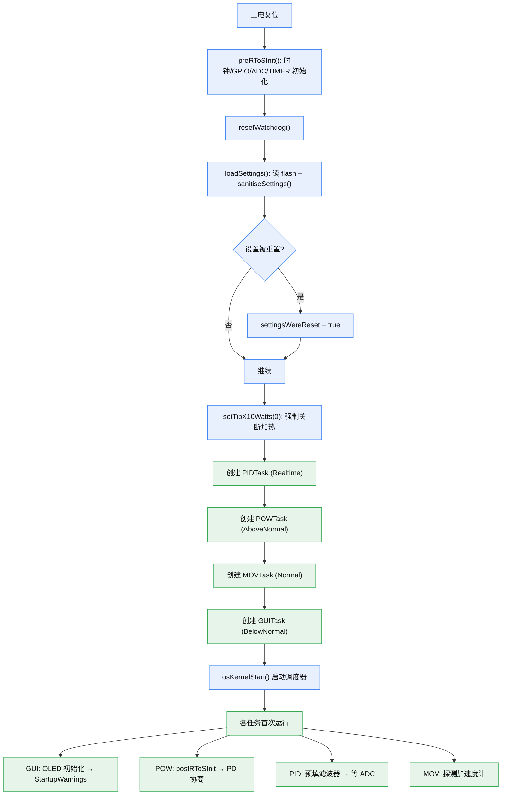
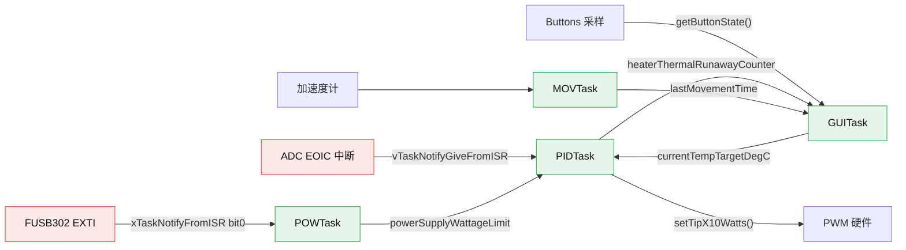

# IronOS 源码详解 01：启动流程与任务模型

> 涉及文件：
> `source/Core/Src/main.cpp`、`source/Core/Inc/main.hpp`、
> `source/Core/BSP/Pinecil/FreeRTOSConfig.h`、`source/Core/BSP/Pinecil/preRTOS.cpp`、
> `source/Core/BSP/Pinecil/postRTOS.cpp`、`source/Core/Src/FreeRTOSHooks.c`、
> `source/Core/Threads/PIDThread.cpp`、`source/Core/Threads/POWThread.cpp`、
> `source/Core/Threads/MOVThread.cpp`、`source/Core/Threads/GUIThread.cpp`

IronOS 只用了 FreeRTOS 的**四个静态任务 + 任务通知**，没有消息队列、没有事件组、
没有软件定时器。理解这套极简模型，是读懂后面所有并发行为的前提。

## 启动链

`main()` 的全部工作就是"把硬件和任务摆好，然后交出 CPU"：

```cpp
int main(void) {
  preRToSInit();

  resetWatchdog();
  // Testing for which accelerometer is mounted
  settingsWereReset = loadSettings(); // load the settings from flash

  setTipX10Watts(0); // force tip off

  resetWatchdog();
  /* Create the thread(s) */
```

（`source/Core/Src/main.cpp:66-75`）

```cpp
  osThreadStaticDef(PIDTask, startPIDTask, osPriorityRealtime, 0, PIDTaskStackSize, PIDTaskBuffer, &PIDTaskControlBlock);
  PIDTaskHandle = osThreadCreate(osThread(PIDTask), NULL);
```

（`source/Core/Src/main.cpp:78-79`）

四个任务用同一套 `osThreadStaticDef + osThreadCreate` 模式创建，区别只在优先级、
栈大小和入口函数。



## 任务表

| 任务 | 入口 | 优先级（数值） | 栈（字 / 字节） | 触发方式 | 周期 |
| --- | --- | --- | --- | --- | --- |
| PIDTask | `startPIDTask` | `osPriorityRealtime`（6） | 512 / 2048 | ADC EOIC 中断 `vTaskNotifyGiveFromISR` | ≈100 ms（快 PWM） |
| POWTask | `startPOWTask` | `osPriorityAboveNormal`（4） | 256 / 1024 | FUSB302 EXTI 通知 + 50 ms 超时 | 事件驱动 |
| MOVTask | `startMOVTask` | `osPriorityNormal`（3） | 512 / 2048 | `vTaskDelay(100 ms)` | 10 Hz |
| GUITask | `startGUITask` | `osPriorityBelowNormal`（2） | 512 / 2048 | `vTaskDelayUntil(40 ms)` | 25 fps |

数值来自 CMSIS-RTOS v1 的优先级定义（Idle=0 … Realtime=6）与
`source/Core/Src/main.cpp:29-46` 的栈常量：

```cpp
osThreadId          GUITaskHandle;
static const size_t GUITaskStackSize = 1024 / 2;
uint32_t            GUITaskBuffer[GUITaskStackSize];
osStaticThreadDef_t GUITaskControlBlock;
```

（`source/Core/Src/main.cpp:43-46`）

`1024 / 2` 的写法容易误解：缓冲区元素类型是 `uint32_t`，所以 512 个元素 = **2048 字节**。
四个任务合计 `2+1+2+2 = 7 KB` RAM，对 GD32VF103（32 KB SRAM）是可接受的开销。

`configMAX_PRIORITIES = 7` 意味着合法优先级 0..6，`Realtime` 已经是最高。
FreeRTOS 配置见 `source/Core/BSP/Pinecil/FreeRTOSConfig.h:10-11`：

```c
#define configTICK_RATE_HZ                      ((TickType_t)1000)
#define configMAX_PRIORITIES                    (7)
```

tick = 1 ms，因此代码里所有 `TICKS_*` 宏都可以直接当毫秒读（`Defines.h:13-16`）。

## 为什么全是静态分配

```c
#define configSUPPORT_STATIC_ALLOCATION  1
#define configSUPPORT_DYNAMIC_ALLOCATION 0
#define configTOTAL_HEAP_SIZE            1024
```

（`source/Core/BSP/Pinecil/FreeRTOSConfig.h:30-32`）

堆只有 1 KB 且动态分配被关闭。原因有三：

1. **可审计**：每个任务的栈在 `.bss` 里是固定符号，链接时就能看出 RAM 够不够；
2. **不会碎片化**：固件要连续运行数月，堆碎片是长期稳定性的天敌；
3. **失败可预测**：`pvPortMalloc` 不存在，任何"忘记静态分配"的代码在链接期就报错。

## 任务间通信：只有任务通知

| 生产者 | 消费者 | 机制 | 语义 |
| --- | --- | --- | --- |
| `ADC0_1_IRQHandler` | PIDTask | `vTaskNotifyGiveFromISR(pidTaskNotification)` | "有新采样了" |
| `EXTI5_9_IRQHandler`（FUSB302 IRQ） | POWTask | `xTaskNotifyFromISR(POWTaskHandle, 1, eSetBits)` | "PD 芯片有事件" |
| GUI / 各模式 | PIDTask | `currentTempTargetDegC`（volatile 全局） | 设定温度 |
| PIDTask | GUI | `heaterThermalRunawayCounter` | 热失控计数 |
| MOVTask | GUI | `lastMovementTime` | 运动时间戳 |
| USBPD | PIDTask | `powerSupplyWattageLimit` | 协商功率上限 |



用通知而不是队列的理由很直接：这里传的都只是"事件发生了"这一位信息，没有数据负载。
队列需要分配存储、维护头尾指针，中断里还要处理满队列；通知是任务 TCB 里的一个计数值，
ISR 里只有几条指令。

代价是**没有缓冲**：如果 PID 任务连续错过两次 ADC 通知，计数会累加，下一次
`ulTaskNotifyTake(pdTRUE, ...)` 会立刻返回并只处理一次（take 会清零计数）。
对控制环来说这反而是正确行为——过期采样没有意义，宁可丢。

## PID 任务的启动时序

`startPIDTask` 在进入主循环前做了三件"预热"工作，顺序不能乱：

```cpp
  // 预热 32 次采样：TipThermoModel 与输入电压都带滑动滤波，空滤波器初值为 0，
  // 直接进闭环会算出巨大误差。每次最多等 5 tick，等不到也继续，属于"尽力预填充"。
  TemperatureType_t PIDTempTarget = 0;
  // Pre-seed the adc filters
  for (int i = 0; i < 32; i++) {
    ulTaskNotifyTake(pdTRUE, 5);
    TipThermoModel::getTipInC(true);
    getInputVoltageX10(getSettingValue(SettingsOptions::VoltageDiv), 1);
  }
```

（`source/Core/Threads/PIDThread.cpp:80-88`）

1. **预填滤波器**（32 次）：`history<>` 与 `expMovingAverage<>` 的初值都是 0，
   不预填的话第一次 PID 会把"0 °C"当成真实温度，算出满功率。
2. **等板级自检**：`while (preStartChecks() == 0)`，MHP30 用它测加热板电阻；
   2 s 超时兜底，避免自检卡死导致永不加热。
3. **等 PD 协商**（仅 `POW_PD==1`）：最多 3 s。因为 PD 协商会改变输入电压，
   而 PID 的功率换算依赖电压；先让电源稳定，避免开机瞬间满功率。

## 栈深与水位的估算

以 PID 任务为例，调用链最深的一条是：

```
startPIDTask → getPIDResultX10Watts → getX10WattageLimits → availableW10
             → getInputVoltageX10 → getADC...（BSP）
```

加上 `TipThermoModel::getTipInC` 内部的查表插值，局部变量不过几十字节；
2 KB 栈对应约 512 个字，余量很大。真正吃栈的是 GUI 任务：`drawScrollingText`、
`OLED::print`、翻译表指针层层嵌套，且 `printf` 风格的调试输出（若开启）会一次吃掉几百字节。
`configCHECK_FOR_STACK_OVERFLOW = 1` 只检查栈指针越界（方法一），
配合 `vApplicationStackOverflowHook` 直接 `reboot()`：

```c
void vApplicationStackOverflowHook(TaskHandle_t xTask, char *pcTaskName) {
  (void)xTask;
  (void)pcTaskName;

  // We dont have a good way to handle a stack overflow at this point in time
  reboot();
}
```

（`source/Core/Src/FreeRTOSHooks.c:40-46`）

## 看门狗的三重喂狗点

| 位置 | 频率 | 含义 |
| --- | --- | --- |
| `vApplicationIdleHook()` | 空闲时 | 系统整体还活着 |
| `setOutputx10WattsViaFilters()` 末尾 | 每个控制周期 | 控制环完整跑通 |
| PID 启动阶段 / POW 等待循环 | 启动期 | 长等待期间不误复位 |

```c
void vApplicationIdleHook(void) { resetWatchdog(); }
```

（`source/Core/Src/FreeRTOSHooks.c:27`）

这个设计的有趣之处：**看门狗不检查"某个任务是否运行"，而检查"系统是否还有空闲"**。
如果任何一个任务死循环且优先级高于 Idle，Idle 永远得不到执行，看门狗溢出复位。
这正是我们想要的——死循环的任务往往就是出问题的任务。

## 任务周期一览

| 任务 | 周期来源 | 实际节拍 | 抖动来源 |
| --- | --- | --- | --- |
| PID | ADC 注入组完成 | ≈10 Hz（快 PWM）/ 5 Hz（慢 PWM） | PWM 模式切换会改变周期 |
| POW | FUSB302 IRQ 或 50 ms 超时 | 事件驱动，最慢 20 Hz | I2C 读取耗时 |
| MOV | `vTaskDelay(TICKS_100MS)` | 10 Hz | 无（相对延时） |
| GUI | `vTaskDelayUntil(40 ms)` | 25 fps | 绘制耗时超过 40 ms 时自然降帧 |

注意 PID 与 GUI 的周期差了两个数量级：GUI 每画一帧，PID 已经调了 2~3 次。
这也是为什么 `currentTempTargetDegC` 用 `volatile` 就够——GUI 写、PID 读，
单次 16 位对齐写入在 Cortex-M/RISC-V 上都是原子的，读到的只会是"旧值或新值"。

## 陷阱与实测建议

- **不要给 PID 任务加阻塞调用**。它一旦阻塞超过 2 s，`ulTaskNotifyTake` 超时分支会
  直接把 PWM 置 0（`PIDThread.cpp` 的 `else { setTipPWM(0, false); }`），表现为"突然不加热"。
- **POW 任务的 50 ms 不是随便定的**：USB-PD 要求 Sink 在 `tSenderResponse`（24 ms 量级）
  内回复，睡太久会丢消息；但完全不睡又会饿死低优先级任务。
- **GUI 优先级最低是有意的**：烙铁的核心功能是控温，界面卡一帧用户感知不到，
  控温晚 10 ms 就可能超调。
- 用调试器看任务状态时，如果发现 Idle 任务从不运行，先怀疑某个任务里有
  `while(1)` 且没有 `vTaskDelay`——这也会让看门狗复位，现象是"随机重启"。

## 相关 KB 条目

- [main_startup.md](../../../05-学习笔记与知识库/Knowledge-Base/ironos/main_startup.md)
- [gui_thread.md](../../../05-学习笔记与知识库/Knowledge-Base/ironos/gui_thread.md)
- [pid_thread.md](../../../05-学习笔记与知识库/Knowledge-Base/ironos/pid_thread.md)
- [pow_thread.md](../../../05-学习笔记与知识库/Knowledge-Base/ironos/pow_thread.md)
