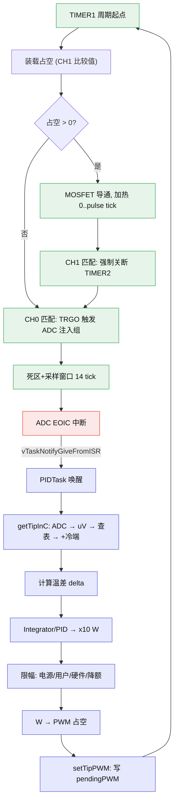

# IronOS 源码详解 02：温度控制环精读

> 涉及文件：
> `source/Core/Threads/PIDThread.cpp`、`source/Core/Src/power.cpp`、
> `source/Core/BSP/Pinecil/IRQ.cpp`、`source/Core/BSP/Pinecil/BSP.cpp`、
> `source/Core/Drivers/TipThermoModel.cpp`、`source/Core/BSP/Pinecil/configuration.h`

这是整个固件最值得读的部分：一个**没有浮点、没有操作系统浮点支持、采样与加热分时复用**
的温度闭环。读懂它，等于读懂了 IronOS 的设计哲学。

## 控制周期全景



关键点：**PID 任务不是定时轮询，而是被 ADC 中断"叫醒"**。因此采样时刻始终锁定在
PWM 周期的固定相位（加热结束 + 死区之后），软件调度抖动不会改变"何时测温度"，
只会让计算晚几十微秒。

## 第一步：把 ADC 码变成温度

```cpp
uint32_t vddRailmVX10 = ADC_VDD_MV * 10; // The vreg is +-2%, but we have no higher accuracy available
// 4096 * 8 readings for full scale
// Convert the input ADC reading back into mV times 10 format.
uint32_t rawInputmVX10 = (rawADC * vddRailmVX10) / (ADC_MAX_READING);

uint32_t valueuV = rawInputmVX10 * 100; // shift into uV
// Now to divide this down by the gain
valueuV /= OP_AMP_GAIN_STAGE;
```

（`source/Core/Drivers/TipThermoModel.cpp:58-69`）

逐行拆解（以 Pinecil V1 为例，`ADC_VDD_MV=3300`、`ADC_MAX_READING=32768`、
`OP_AMP_GAIN_STAGE=317`）：

```
rawADC = 16000
rawInputmVX10 = 16000 * 33000 / 32768 = 16113   （即 1611.3 mV）
valueuV       = 16113 * 100 = 1611300 uV        （运放输出端）
valueuV       = 1611300 / 317 = 5082 uV         （热电偶端）
```

5082 uV 大致对应 500 °C 左右的 K 型热电偶输出（K 型约 41 uV/°C，500 °C 时约 20 mV，
但这里经过分压与偏置，实际曲线由查表决定）。查表在板级文件里：

```cpp
const int32_t uVtoDegC[] = {
    //
    // uv -> temp in C
    0,     0,   //
    266,   10,  //
    522,   20,  //
```

（`source/Core/BSP/Pinecil/ThermoModel.cpp:12-16`）

表是"每 10 °C 一个点"的 `(uV, °C)` 对，`Utils::InterpolateLookupTable` 做线性插值。
注意表项是**分段非线性**的：0→10 °C 需要 266 uV，而 300→310 °C 需要 273 uV，
单位温升所需的 uV 随温度升高而略增，这正是热电偶的 Seebeck 系数随温度变化的体现。

最后加冷端：

```cpp
TemperatureType_t currentTipTempInC = TipThermoModel::convertTipRawADCToDegC(getTipRawTemp(sampleNow));
currentTipTempInC += getHandleTemperature(sampleNow) / 10; // Add handle offset
```

（`source/Core/Drivers/TipThermoModel.cpp:119-120`）

`getHandleTemperature()` 返回 0.1 °C 单位，所以除以 10。手柄 NTC（TMP36）的换算在
`BSP.cpp:24-43`：先减 0.5 V 偏置（4965 counts），再按 99.3 counts/°C 换算。

## 第二步：控制器

### 默认控制器：自衰减积分器

Pinecil V1、TS100 等机型用 `Integrator`（`TIP_CONTROL_PID` 未定义），Pinecil V2 用
标准 PID（`configuration.h:174-175`）。先看默认实现：

```cpp
  T update(const T val, const int32_t inertia, const int32_t gain, const int32_t rate, const int32_t limit) {
    // Decay the old value. This is a simplified formula that still works with decent results
    // Ideally we would have used an exponential decay but the computational effort required
    // by exp function is just not justified here in respect to the outcome
    sum = (sum * (100 - (inertia / rate))) / 100;
    // Add the new value x integration interval ( 1 / rate)
    sum += (gain * val) / rate;
```

（`source/Core/Threads/PIDThread.cpp:244-250`）

数学形式：

```
S[k] = S[k-1] * (1 - inertia/(100*rate)) + gain * val / rate
```

代入 Pinecil 参数（`inertia = 65`、`gain = 2`、`rate ≈ 10 Hz`）：

```
衰减系数 = 1 - 65/(100*10) = 1 - 0.065 = 0.935
每周期增量 = 2 * val / 10 = 0.2 * val
```

其中 `val = 热容 × 温差 = 65 × ΔT`（x10 J/°C × °C = x10 J，配合 1 s 归一化就是 x10 W）。
于是：

```
S[k] = 0.935*S[k-1] + 13*ΔT
```

稳态增益（ΔT 恒定）：

```
S_ss = 13*ΔT / (1-0.935) = 200*ΔT   （x10 W）
```

即 **每 1 °C 误差对应 20 W 的稳态输出**。这个增益相当高，但因为有 0.935 的衰减，
它对"突发误差"的响应又不像纯积分那么激进——大误差时第一拍只加到 `13*ΔT`，
需要约 `1/0.065 ≈ 15` 个周期（1.5 s）才逼近稳态。这就是原作者注释里说的
"大误差时像 P，接近设定点时像 I"。

数值例子（目标 320 °C，实测 300 °C，ΔT=20）：

| 周期 | 计算 | S（x10 W） | 实际功率 |
| --- | --- | --- | --- |
| 0 | 0.935×0 + 13×20 | 260 | 26 W |
| 1 | 0.935×260 + 260 | 503 | 50 W |
| 2 | 0.935×503 + 260 | 730 | 73 W（会被限幅到 ~487） |

三轮就到限幅，所以**冷启动几乎总是满功率**，真正的调节发生在接近设定点之后。

### 限幅与抗饱和

```cpp
    // constrain the output between +- our max power output, this limits windup when doing the inital heatup or when solding something large
    if (sum > limit) {
      sum = limit;
    } else if (sum < -limit) {
      sum = -limit;
    }
```

（`source/Core/Threads/PIDThread.cpp:252-257`）

`limit` 来自 `getX10WattageLimits()`，在 Pinecil + 20 V + 7.5 Ω 下约 487（48.7 W）。
积分量被夹在 ±limit，避免"冷启动时积分涨到几十万，到温后要几十秒才退下来"的超调。

### 可选：标准 PID

```cpp
    integration_running_sum += (target_delta * (T)interval_ms * Ki) / 1000;
```

（`source/Core/Threads/PIDThread.cpp:199`）

Pinecil V2 的 `TIP_PID_KP=40`、`TIP_PID_KI`/`TIP_PID_KD` 由同一段配置给出。
它按实际 `interval_ms` 归一化，所以快/慢 PWM 切换不会让积分突变。

## 第三步：功率 → PWM

```cpp
void setTipX10Watts(int32_t mw) {
  int32_t    outputPWMLevel   = X10WattsToPWM(mw, 1);
  const bool shouldUseFastPWM = shouldBeUsingFastPWMMode(outputPWMLevel);
  setTipPWM(outputPWMLevel, shouldUseFastPWM);
  uint32_t actualMilliWatts = PWMToX10Watts(outputPWMLevel, 0);

  x10WattHistory.update(actualMilliWatts);
}
```

（`source/Core/Src/power.cpp:59-66`）

这里有一个容易被忽略的设计：**每次设定功率都回读一次"实际功率"并进滑动平均**。
GUI 上显示的功率条不是 PID 的目标值，而是"按当前电压估算的真实输出"，
所以电池电量下降时用户能看到功率条同步变短。

`X10WattsToPWM` 的核心是一句比例换算：

```cpp
  pwm = (powerPWM * x10Watts) / availableW10(sample);
```

（`source/Core/Src/power.cpp:122`）

而 `availableW10()` 里：

```cpp
  uint32_t availableWattsX10 = (v * v) / tipResistance;
  // However, 100% duty cycle is not possible as there is a dead time while the ADC takes a reading
  // Therefore need to scale available milliwats by this

  // avMw=(AvMw*powerPWM)/totalPWM.
  // 占空修正：总周期 = 加热段 powerPWM + 采样窗口 tempMeasureTicks + 死区 holdoffTicks，
  // 因此实际可交付功率要按 powerPWM/totalPWM 打折（Pinecil 上约 255/279 ≈ 91%）。
  availableWattsX10 = availableWattsX10 * powerPWM;
  availableWattsX10 /= totalPWM;
```

（`source/Core/Src/power.cpp:89-97`）

`v` 的单位是 0.1 V、`tipResistance` 是 0.1 Ω，所以 `v*v/R` 的量纲正好是 0.1 W，
不需要额外缩放。这一步是**电压前馈**：同样 50 W 的请求，在 9 V 下要 90% 占空，
在 20 V 下只要 40%，换算自动完成，PID 不需要知道输入电压。

## 第四步：输出前的保护链

```cpp
  // 与 detectThermalRunaway 里的贴顶判断互补：那里累计计数，这里立即断输出。
  // 阈值 0x7FFF-32 表示已进入满量程最后 32 个计数（约 0.1% 量程）。
  // Secondary safety check to forcefully disable header when within ADC noise of top of ADC
  if (getTipRawTemp(0) > (0x7FFF - 32)) {
    x10WattsOut = 0;
  }
```

（`source/Core/Threads/PIDThread.cpp:470-475`）

顺序是：KeepAwakePulse 抬底 → ADC 贴顶保护 → 热失控计数保护 → 可选斜率限制 →
`setTipX10Watts()` → `resetWatchdog()`。任何一步失败都不会继续加热。

## 快/慢 PWM 的切换逻辑

```cpp
bool shouldBeUsingFastPWMMode(const uint8_t pwmTicks) {
  // Determine if we should use slow or fast PWM mode
  // Crossover between modes set around the midpoint of the PWM control point
  static bool lastPWMWasFast = true;
  if (pwmTicks > (fastPWMChangeoverPoint + fastPWMChangeoverTolerance) && lastPWMWasFast) {
    lastPWMWasFast = false;
  } else if (pwmTicks < (fastPWMChangeoverPoint - fastPWMChangeoverTolerance) && !lastPWMWasFast) {
    lastPWMWasFast = true;
  }
  return lastPWMWasFast;
}
```

（`source/Core/Src/power.cpp:40-51`）

`fastPWMChangeoverPoint=128`、`Tolerance=16`，所以：

- 占空 > 144 → 切慢模式（500 Hz）
- 占空 < 112 → 切快模式（1 kHz）
- 112..144 之间保持原状态（迟滞，防止抖动）

慢模式的周期是 `255+7+5=267`，采样窗口与死区都减半，但**控制周期翻倍**（约 5 Hz）。
这不是问题：大占空比意味着接近满功率，系统处于"粗调"阶段，5 Hz 足够。

```cpp
void switchToFastPWM(void) {
  fastPWM           = true;
  totalPWM          = powerPWM + tempMeasureTicks + holdoffTicks;
  TIMER_CAR(TIMER1) = (uint32_t)totalPWM;

  // ~10Hz
  TIMER_CH0CV(TIMER1) = powerPWM + holdoffTicks;
  // 1 kHz tick rate
  TIMER_PSC(TIMER1) = 18000;
}
```

（`source/Core/BSP/Pinecil/IRQ.cpp:101-110`）

注释里的 `~10Hz` 与 `1 kHz tick rate` 指的是两件事：前者是**控制/采样率**，
后者是**计数器 tick 率**。按 `PSC=18000`、`period=279` 计算，整周期确实落在
10 Hz 量级（不同主频下略有出入），这与 `PID_TIM_HZ=8` 的配置相互印证。

## 热失控检测

```cpp
void detectThermalRunaway(const TemperatureType_t currentTipTempInC, const uint32_t x10WattsOut) {

  // 这些 static 是跨调用的"观测窗口"，一次检测横跨数十秒，不能放在栈上。
  // haveSeenDelta 一旦置位就永久跳过后续统计（每次上电只判定一次）。
  static TemperatureType_t tiptempMin         = 0xFFFF; // Min tip temp seen
  static TemperatureType_t tipTempMax         = 0;      // Max tip temp seen while heater is on
```

（`source/Core/Threads/PIDThread.cpp:350-355`）

两条判据：

1. **关断时贴顶**：`!heating && rawTemp > ADC_MAX_READING-8` → 计数 +1。
   物理含义是 MOSFET 击穿，即使固件关断，电流仍在加热。
2. **加热 20 s 温升不足**：`tipTempMax - tipTempMin < 3 °C` → 计数 +1。
   物理含义是测温链路坏了（热电偶断路/运放饱和），温度读数卡住。

计数器每秒衰减 1（主循环末尾），`>8` 时 `setOutputx10WattsViaFilters` 强制输出 0，
并且 `Soldering.cpp` 会切到 `ThermalRunaway` 页面。**9 秒的持续时间**是刻意的：
拔插烙铁头会产生 1~2 秒的异常读数，不应该直接关机。

## 数据流全景


这张图里每个箭头都对应一次真实的函数调用或寄存器写入：
`convertTipRawADCTouV()` → `convertuVToDegC()` → `getTipInC()` →
`getPIDResultX10Watts()` → `X10WattsToPWM()` → `setTipPWM()`。

## 实测：如何判断控制环是否健康

| 现象 | 可能原因 | 检查点 |
| --- | --- | --- |
| 温度在设定点附近 ±30 °C 振荡 | 积分增益过高/采样噪声大 | `Integrator` 的 `inertia`、`getTipRawTemp` 的滤波 |
| 到温后长时间超调 50 °C+ | 抗饱和失效 | `limit` 是否被 `getX10WattageLimits` 算成 0 |
| 显示温度明显低于实际 | 冷端补偿/校准偏置 | `CalibrationOffset`、`getHandleTemperature` |
| 功率条满格但化不了锡 | PD 只谈到 5 V | `availableW10` 的输入电压 |
| 每 20 s 左右突然断输出 | 热失控误判 | `detectThermalRunaway` 的 min/max 统计 |

## 读码路径小结

1. `IRQ.cpp` 的 `ADC0_1_IRQHandler` → 理解"谁叫醒 PID"。
2. `PIDThread.cpp:115-150` 主循环 → 理解"每个周期做什么"。
3. `power.cpp` 的 `availableW10`/`X10WattsToPWM` → 理解"功率怎么变成占空"。
4. `TipThermoModel.cpp` → 理解"ADC 怎么变成温度"。
5. 最后回头看 `getX10WattageLimits()`，它把电源、用户、硬件、手柄四层限制串起来，
   是理解"为什么有时明明设了 400 °C 却上不去"的钥匙。

## 陷阱与实测建议

- **不要在 `setTipX10Watts` 之外直接写 PWM**：它维护 `x10WattHistory`，绕过它会让
  GUI 功率显示与实际不符。
- **`getX10WattageLimits()` 内部会触发 ADC 采样**，在中断里调用会造成重入。
- **修改 `TIP_THERMAL_MASS` 等价于改控制器增益**：它同时出现在积分增量和稳态增益里，
  调大 10% 约等于增益调大 10%。
- 用示波器看 TIMER2 输出时，注意慢模式下周期会突然变成两倍——这不是故障，
  是 `shouldBeUsingFastPWMMode` 的迟滞在起作用。

## 相关 KB 条目

- [pid_thread.md](../../../05-学习笔记与知识库/Knowledge-Base/ironos/pid_thread.md)
- [power_cpp.md](../../../05-学习笔记与知识库/Knowledge-Base/ironos/power_cpp.md)
- [tip_thermo_model.md](../../../05-学习笔记与知识库/Knowledge-Base/ironos/tip_thermo_model.md)
- [bsp_pinecil_irq.md](../../../05-学习笔记与知识库/Knowledge-Base/ironos/bsp_pinecil_irq.md)
