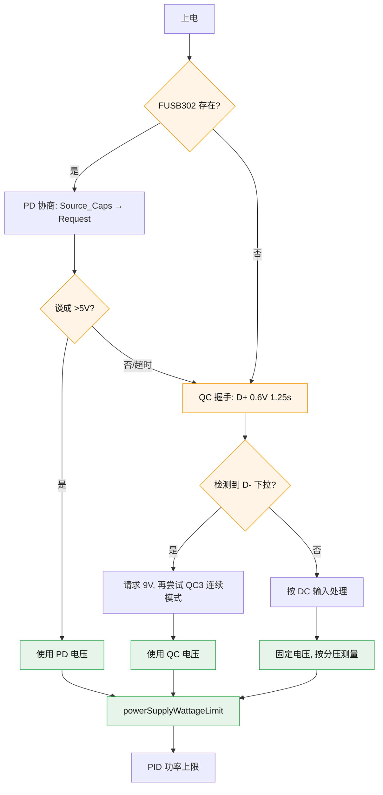
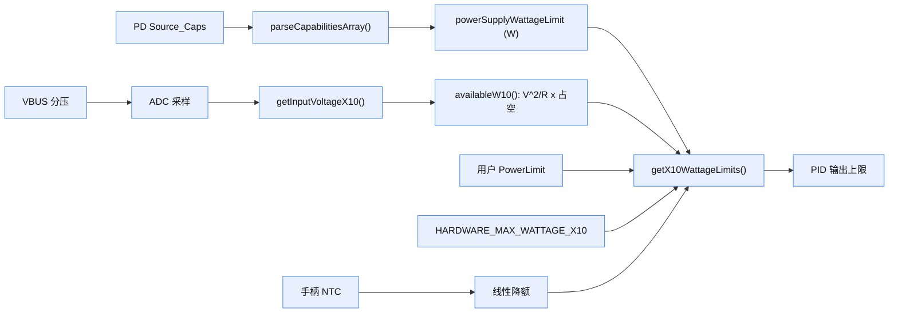

# IronOS 源码详解 03：电源管理与 USB PD

> 涉及文件：
> `source/Core/Threads/POWThread.cpp`、`source/Core/Drivers/USBPD.cpp`、
> `source/Core/Src/QC3.cpp`、`source/Core/BSP/Pinecil/QC_GPIO.cpp`、
> `source/Core/BSP/Pinecil/Power.cpp`、`source/Core/Threads/PIDThread.cpp`

Pinecil 的性能几乎完全由"能从充电器拿到多少瓦"决定：7.5 Ω 的烙铁头在 5 V 下只有
3.3 W，在 20 V 下有 53 W。电源子系统的任务就是**尽快、尽量高**地谈到电压，同时
在电源撑不住时及时降额。

## 三条供电路径与优先级

| 路径 | 触发条件 | 电压范围 | 代码 |
| --- | --- | --- | --- |
| USB-PD | `POW_PD=1` 且 FUSB302 存在 | 5/9/12/15/20 V，可 PPS/AVS | `Drivers/USBPD.cpp` |
| QC 2.0/3.0 | PD 未成功且 `POW_QC=1` | 5/9/12/20 V，QC3 可 0.2 V 步进 | `Src/QC3.cpp` + BSP `QC_GPIO.cpp` |
| DC / 普通 USB | 以上都没有 | 固定，靠分压测量 | `BSP/*/Power.cpp` |



## POWTask：事件驱动的 PD 引擎

```cpp
void startPOWTask(void const *argument __unused) {

  // Init any other misc sensors
  // postRToSInit 里做"必须在调度器启动后才能做"的板级初始化（如 BLE/外设时钟）。
  // 放在本任务而不是 main，是为了让 GUI 先亮屏，用户感知不到这段延迟。
  postRToSInit();
```

（`source/Core/Threads/POWThread.cpp:38-43`）

```cpp
  // You have to run this once we are willing to answer PD messages
  // Setting up too early can mean that we miss the ~20ms window to respond on some chargers
#ifdef POW_PD
  // 关键时序：start() 内部会做 FUSB302 初始化并打开 IRQ。太早初始化会错过
  // 上电后充电器发 Source_Capabilities 的窗口（部分充电器只发一次），
  // 所以必须等调度器起来、VBUS 稳定后再开始。
  USBPowerDelivery::start();
```

（`source/Core/Threads/POWThread.cpp:52-55`）

主循环的核心是一个"不等满 100 ms"的技巧：

```cpp
    res = pdFALSE;
    // While the interrupt is low, dont delay
    /*This is due to a possible race condition, where:
     * IRQ fires
     * We read interrupt register but dont see the Good CRC
     * Then Good CRC is set while reading it out (racing on I2C read)
     * Then we would sleep as nothing to do, but 100ms> 20ms power supply typical timeout
     */
```

（`source/Core/Threads/POWThread.cpp:68-75`）

USB-PD 规定 Sink 收到消息后要在 `tSenderResponse`（24 ms 量级）内回 `GoodCRC`。
如果主循环在"看起来没事"时睡 100 ms，就会错过这个窗口，充电器会重发甚至放弃。
所以等待时间被压到 50 ms，并且每次醒来都无条件 `step()` 一次状态机。

## PD 协商：我们从充电器要什么

### 第一步：声明 Sink Capabilities

```cpp
void pdbs_dpm_get_sink_capability(pd_msg *cap, const bool isPD3) {
  /* Keep track of how many PDOs we've added */
  int numobj = 0;

  /* If we have no configuration or want something other than 5 V, add a PDO
   * for vSafe5V */
  /* Minimum current, 5 V, and higher capability. */
  cap->obj[numobj++] = PD_PDO_TYPE_FIXED | PD_PDO_SNK_FIXED_VOLTAGE_SET(PD_MV2PDV(5000)) | PD_PDO_SNK_FIXED_CURRENT_SET(DPM_MIN_CURRENT);
  // Voltages must be in order of lowest -> highest
#if USB_PD_VMAX >= 20
  add_v_record(cap, 9000, numobj);
  numobj++;
  add_v_record(cap, 15000, numobj);
  numobj++;
  add_v_record(cap, 20000, numobj);
  numobj++;
```

（`source/Core/Drivers/USBPD.cpp:455-470`）

第一档必须是 5 V（PD 规范强制），后续按 `USB_PD_VMAX` 递增排列。Pinecil V1 的
`USB_PD_VMAX=20`，所以声明 5/9/15/20 V；V2 是 28，还会走 EPR 分支。

每条记录的电流由 `add_v_record` 用 `I = V/R` 现算：

```cpp
  uint16_t current = (voltage_mv) / getTipResistanceX10(); // In centi-amps
```

（`source/Core/Drivers/USBPD.cpp:442`）

这不是"我想要 3 A"，而是"我这个电阻在这个电压下会吃这么多电流"，等于向充电器
诚实地声明负载特性。

### 第二步：从 Source Capabilities 里挑一档

```cpp
      int voltage_mv             = PD_PDV2MV(PD_PDO_SRC_FIXED_VOLTAGE_GET(lastCapabilities[i])); // voltage in mV units
      int current_a_x100         = PD_PDO_SRC_FIXED_CURRENT_GET(lastCapabilities[i]);            // current in 10mA units
      // 单位推导：mV / (10 mA) = 0.1 Ω，正好与 tipResistance（0.1 Ω 单位）同量纲，
      // 所以可以直接比较，不需要再乘除 100。
      int min_resistance_ohmsx10 = voltage_mv / current_a_x100;
      if (voltage_mv > 0) {
        if (voltage_mv <= (USB_PD_VMAX * 1000)) {
          if (voltage_mv <= 20000 || (pd_mode != usbpdMode_t::NO_DYNAMIC)) {
            if (min_resistance_ohmsx10 <= tipResistance) {
```

（`source/Core/Drivers/USBPD.cpp:218-226`）

判据的物理意义：`V/I` 是"这档电源能驱动的最小电阻"。如果它大于烙铁电阻，
说明这档给不了足够电流，插上去会把充电器拉进限流/重启。举例（Pinecil，R=7.5 Ω）：

| 档位 | min_resistance (0.1 Ω) | 与 80（含 0.5 Ω 补偿）比较 | 结果 |
| --- | --- | --- | --- |
| 5 V / 3 A | 5000/300 = 16 | ≤ 80 | 可用（但功率低） |
| 9 V / 2 A | 9000/200 = 45 | ≤ 80 | 可用 |
| 20 V / 1.5 A | 20000/150 = 133 | > 80 | **不可用**（电流不够） |
| 20 V / 3 A | 20000/300 = 66 | ≤ 80 | 可用，选它 |

`tipResistance += 5` 只发生在 `USBPDMode::DEFAULT`：相当于把烙铁当成 8.0 Ω，
让充电器多给一点余量，补偿线缆与 PCB 的压降。SAFE 模式不加这个"虚报"。

### 第三步：PPS / AVS 的连续调压

固定档只有几档电压，PPS 可以在范围内连续调。选择逻辑是解方程：

```cpp
        int ideal_voltage_mv = (tipResistance * max_current);
        if (ideal_voltage_mv > max_voltage) {
          ideal_voltage_mv = max_voltage; // constrain to what this PDO offers
        }
        if (ideal_voltage_mv > 20000) {
          ideal_voltage_mv = 20000; // Limit to 20V as some advertise 21 but are not stable at 21
        }
```

（`source/Core/Drivers/USBPD.cpp:264-270`）

`V = I_max × R` 就是"用满这档电流所需的最低电压"。再夹到档位上限、20 V 硬上限、
机型 `USB_PD_VMAX`。20 V 的额外夹取值得注意：有些充电器标称 21 V 但带载会跌，
固件主动避开。

EPR/AVS 则是功率约束：`V = sqrt(P × R)`，用整数平方根 `sqrtI()` 实现
（`source/Core/Drivers/USBPD.cpp:151-172`），避免在无 FPU 的 MCU 上引入浮点库。

### 第四步：结果如何影响加热

```cpp
    /* Update requested voltage */
    requested_voltage_mv    = bestIndexVoltage;
    powerSupplyWattageLimit = bestIndexVoltage * bestIndexCurrent / 100 / 1000; // Set watts for limit from PSU limit
```

（`source/Core/Drivers/USBPD.cpp:415-417`）

单位拆解：`mV × (10 mA) = 10^-5 W`，除以 100 得 W，再除以 1000 是把
`bestIndexCurrent` 的 10 mA 单位折进去，最终得到**瓦特**。
这个值随后在 `getX10WattageLimits()` 里被乘以 10 与其它限值比较：

```cpp
  if (powerSupplyWattageLimit && limit > powerSupplyWattageLimit * 10) {
    limit = powerSupplyWattageLimit * 10;
  }
```

（`source/Core/Threads/PIDThread.cpp:415-417`）

## QC 3.0 握手

PD 谈不成（或没有 FUSB302）时，Pinecil 退到 QC。握手流程在 `startQC()`：

```cpp
  if (enteredQC) {
    // We have a QC capable charger
    QC_Seek9V();
    QC_Post_Probe_En();
    QC_Seek9V();
    // Wait for frontend ADC to stabilise
    QCMode = QCState::QC_2;
    for (uint8_t i = 0; i < 10; i++) {
      if (getInputVoltageX10(divisor, 0) > 80) {
        // yay we have at least QC2.0 or QC3.0
        QCMode = QCState::QC_3; // We have at least QC2, pray for 3
        return;
      }
      vTaskDelay(TICKS_100MS); // 100mS
    }
```

（`source/Core/Src/QC3.cpp:181-192`）

`getInputVoltageX10() > 80` 就是"VBUS > 8 V"，用来确认充电器真的升压了。
判成 `QC_3` 后，`seekQC()` 会用 `QC_SeekContPlus/Neg` 以 0.2 V 步进逼近用户设定的
`QCIdealVoltage`：

```cpp
    while (steps > 0) {
      QC_SeekContPlus();
      vTaskDelay(3 * TICKS_10MS);
      steps--;
    }
```

（`source/Core/Src/QC3.cpp` 的 `seekQC`）

每一步 30 ms，是因为 QC3 的连续模式要求 D+/D- 上的脉冲宽度在毫秒级，
太快充电器识别不到，太慢则用户会看到电压"爬升"很慢。

`QC_resync()` 在 `power_check()` 里被反复调用，作用是**持续纠偏**：
充电器可能因为负载突变把电压拉回 5 V，`seekQC` 会发现偏差并重新爬升。

## 电源类型判定

```cpp
void power_check() {
#ifdef POW_PD
  // Cant start QC until either PD works or fails
  if (!USBPowerDelivery::negotiationComplete()) {
    return;
  }
  if (USBPowerDelivery::negotiationHasWorked()) {
    return; // We are using PD
  }
#endif
#ifdef POW_QC
  QC_resync();
#endif
}
```

（`source/Core/BSP/Pinecil/Power.cpp:9-22`）

`getIsPoweredByDCIN()` 是它的镜像：只有"PD 没谈成、QC 也没谈成"才认为是 DC。
这个判定被三处使用：

1. `checkForUnderVoltage()`：DC 输入才检查欠压（PD/QC 的电压由协议保证）。
2. `PIDThread` 的 DC 最低电压保护。
3. GUI 的电源图标显示。



## 量化：不同电源下的实际上限

以 Pinecil（R=7.5 Ω，占空修正 91.4%）计算 `availableW10`：

| 电源 | 电压 | 理论 P=V²/R | 乘占空修正 | 实际限值 |
| --- | --- | --- | --- | --- |
| 普通 USB | 5 V | 3.3 W | 3.0 W | 3.0 W |
| QC 9 V | 9 V | 10.8 W | 9.9 W | 9.9 W |
| PD 15 V | 15 V | 30 W | 27.4 W | 27.4 W |
| PD 20 V | 20 V | 53.3 W | 48.7 W | 48.7 W（未触 75 W 硬件上限） |

所以"20 V 档"带来的不是 4 倍而是约 **16 倍** 的加热功率（相对 5 V），
这也是为什么 PD 协商失败时用户体验会断崖式下降。

## 陷阱与实测建议

- **PD 协商超时设置（`PDNegTimeout`）不是越大越好**：某些充电器在超时后会停止重发
  Source_Caps，表现为"插上没反应"。默认 20（2 s）是社区实测的折中。
- **`powerSupplyWattageLimit` 单位是 W，不是 x10 W**，与 `getX10WattageLimits()` 的
  返回值差 10 倍，读代码时极易混淆（函数名里已经标注）。
- **QC 与 PD 不能同时进行**：`power_check()` 先等 PD 有结论，避免在 PD 协商中途
  把 D+/D- 拉来拉去做 QC，导致充电器复位。
- 实测 PD 时用带协议分析的 USB 表（如 FNIRSI/KKmoon），能看到 `Source_Caps` 里的
  实际档位；如果充电器只给 5 V/0.5 A，多半是 e-marker 线缆或 CC 电阻问题，与固件无关。
- **不要在没有 VBUS 的情况下反复 `USBPowerDelivery::start()`**：FUSB302 由 VBUS 供电，
  拔线后 I2C 会全部失败，表现为 POW 任务卡在 I2C 超时（现象是界面变慢）。

## 相关 KB 条目

- [usbpd.md](../../../05-学习笔记与知识库/Knowledge-Base/ironos/usbpd.md)
- [qc3.md](../../../05-学习笔记与知识库/Knowledge-Base/ironos/qc3.md)
- [pow_thread.md](../../../05-学习笔记与知识库/Knowledge-Base/ironos/pow_thread.md)
- [power_cpp.md](../../../05-学习笔记与知识库/Knowledge-Base/ironos/power_cpp.md)
