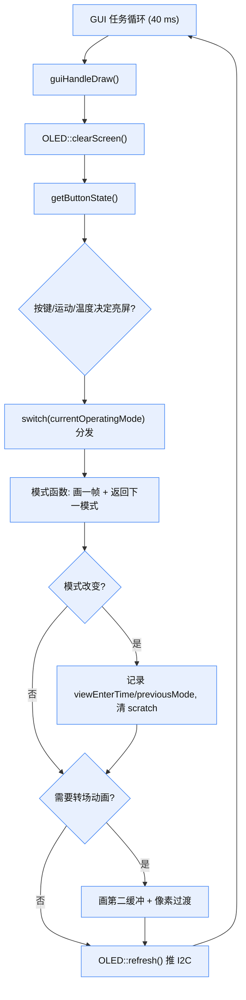
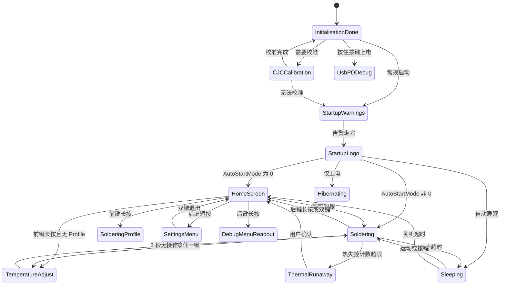
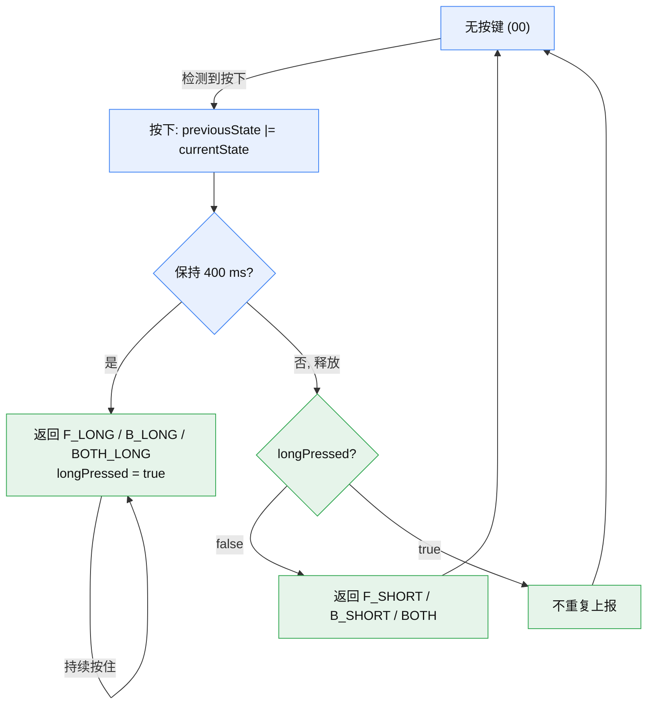
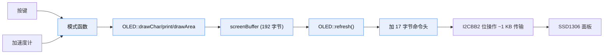

# IronOS 源码详解 04：用户界面与按键状态机

> 涉及文件：
> `source/Core/Threads/GUIThread.cpp`、`source/Core/Threads/UI/logic/OperatingModes.h`、
> `source/Core/Threads/UI/logic/HomeScreen.cpp`、`source/Core/Threads/UI/logic/Soldering.cpp`、
> `source/Core/Threads/UI/logic/Sleep.cpp`、`source/Core/Threads/UI/logic/SettingsMenu.cpp`、
> `source/Core/Drivers/Buttons.cpp`、`source/Core/Drivers/OLED.cpp`、`source/Core/Src/settingsGUI.cpp`

IronOS 的 GUI 没有用 LVGL 之类的框架：它是一台 **25 fps 的立即模式渲染器** +
一张 **模式分发表** + 一个 **按键状态机**。整个界面逻辑约 3000 行，却能在 96×16 的
单色屏上做出转场动画、滚动文字、多级菜单和图标动画。

## 三层结构

| 层 | 文件 | 职责 |
| --- | --- | --- |
| 任务层 | `GUIThread.cpp` | 每 40 ms 画一帧、处理模式切换、跑转场动画 |
| 逻辑层 | `Threads/UI/logic/*.cpp` | 每个模式一个纯函数：`(按键, context) → 下一模式` |
| 绘制层 | `Threads/UI/drawing/*` | 只负责把像素画进 framebuffer，不读按键 |



## 模式枚举：一个 `enum class` 定义整个状态机

```cpp
enum class OperatingMode {
  StartupLogo        = 10, // Showing the startup logo
  CJCCalibration     = 11, // Cold Junction Calibration
  StartupWarnings    = 12, // Startup checks and warnings
  InitialisationDone = 13, // Special state we use just before we to home screen at first startup. Allows jumping to extra startup states
  HomeScreen         = 0,  // Home/Idle screen that is the main launchpad to other modes
  Soldering          = 1,  // Main soldering operating mode
```

（`source/Core/Threads/UI/logic/OperatingModes.h:31-38`）

枚举值刻意不连续：0..9 是"运行期模式"，10..14 是"启动期模式"。
这不是美学选择，而是历史兼容——早期版本把模式值写进了 `guisettings`，
新增启动模式时只能往上加，不能重排。

### 状态迁移图



（`stateDiagram-v2` 的迁移标签里刻意避开了括号，只保留中文与冒号。）

## 一帧做了什么

```cpp
OperatingMode guiHandleDraw(void) {
  OLED::clearScreen(); // Clear ready for render pass
  // Read button state
  ButtonState buttons = getButtonState();
```

（`source/Core/Threads/GUIThread.cpp:68-71`）

**每帧都清屏重画**，没有"脏矩形"优化。原因很实际：96×16 的整屏只有 192 字节，
重画的成本远低于维护脏区域状态机的复杂度。

息屏判定：

```cpp
    // 息屏条件：温度 < 50 C（不烫手）+ 运动感应开启 + 运动和按键都静默超过 60 s。
    // 温度门限的意义：烙铁还热着就把屏幕关掉，用户会误以为已断电。
    uint32_t tipTemp = TipThermoModel::getTipInC();
    if ((tipTemp < 50) && getSettingValue(SettingsOptions::Sensitivity) &&
        (((xTaskGetTickCount() - lastMovementTime) > MOVEMENT_INACTIVITY_TIME) && ((xTaskGetTickCount() - lastButtonTime) > BUTTON_INACTIVITY_TIME))) {
      OLED::setDisplayState(OLED::DisplayState::OFF);
      setStatusLED(LED_OFF);
```

（`source/Core/Threads/GUIThread.cpp:80-86`）

`MOVEMENT_INACTIVITY_TIME` 与 `BUTTON_INACTIVITY_TIME` 都是 `60 * configTICK_RATE_HZ`
= 60 秒（`GUIThread.cpp:42-43`）。注意条件里用的是"与"：运动和按键**都**静默才息屏，
防止用户拿着不动但一直在按键时黑屏。

## 模式切换的收尾

```cpp
  if (newMode != currentOperatingMode) {
    context.viewEnterTime = xTaskGetTickCount();
    context.previousMode  = currentOperatingMode;
```

（`source/Core/Threads/GUIThread.cpp:201-203`）

三件事必须做：

1. `viewEnterTime`：转场动画的时间原点；
2. `previousMode`：让 `TemperatureAdjust` 知道退出后回哪（可能是 Soldering 或 Home）；
3. `memset(&context.scratch_state, 0, ...)`：**清空 scratch**。

第 3 点是最容易踩坑的地方：`scratch_state` 的 7 个字段没有语义，各模式按需解释。
如果不清零，从 SettingsMenu（state1=菜单下标）切到 Soldering（state1=按键锁状态）时，
就会把"菜单下标 3"当成"已锁定"，表现为"刚进焊接模式按键就没反应"。

## 转场动画：双缓冲

```cpp
  if (context.transitionMode != TransitionAnimation::None) {
    OLED::useSecondaryFramebuffer(true);
    // Now we need to fill the secondary buffer with the _next_ frame to transistion to
    guiHandleDraw();
    OLED::useSecondaryFramebuffer(false);
```

（`source/Core/Threads/GUIThread.cpp:222-226`）

动画需要"当前帧"和"下一帧"同时存在，所以 `guiHandleDraw()` 被调用两次：
第一次画当前模式，第二次切到第二缓冲画下一模式，然后 `OLED` 模块做像素插值
（`transitionScrollUp/Down`、`transitionSecondaryFramebuffer`）。

代价是**转场那一帧的 CPU 时间翻倍**，而 GUI 任务优先级最低，所以转场时更容易掉帧。
这就是 `animOpenState` 存在的原因：菜单切换动画期间暂停图标动画，别让两套动画抢 I2C。

## 按键状态机

`getButtonState()` 每帧被调用一次（GUI 的 40 ms 节拍），它维护三个 static：

```cpp
  static uint8_t    previousState       = 0;
  static bool       longPressed         = false;
  static TickType_t previousStateChange = 0;
  const TickType_t  timeout             = TICKS_100MS * 4;
  uint8_t           currentState;
  currentState = (getButtonA()) << 0;
  currentState |= (getButtonB()) << 1;
```

（`source/Core/Drivers/Buttons.cpp:40-46`）

状态编码：bit0 = 前键（A），bit1 = 后键（B）。`timeout = 4 * 100 ms = 400 ms`。



两个细节值得注意：

```cpp
      // User has pressed a button down (nothing done on down)
      // If there is a rising edge on one of the buttons from double press we
      // want to mask that out As users are having issues with not release
      // both at once
      previousState |= currentState;
```

（`source/Core/Drivers/Buttons.cpp:73-77`）

用 `|=` 而不是 `=`，使得"先按 A 再按 B、先松 A 再松 B"仍然被识别为 `BOTH`。
如果用 `=`，第二次按下会把第一次的位覆盖掉，双键手势就永远触发不了。

`SHORT` 的语义是"按下+释放的完整脉冲"，所以**按下瞬间什么都不会发生**。
这避免了用户按住不放时界面连续触发。

## 设置菜单：数据驱动的二级菜单

菜单不是代码逻辑，而是一张表：

```cpp
typedef struct {
  // The settings description index, please use the `SETTINGS_DESC` macro with
  // the `SettingsItemIndex` enum. Use 0 for no description.
  uint8_t description;
  void (*const incrementHandler)(void);
  void (*const draw)(void); // Must not be nullptr, as that marks end of menu
  bool (*const isVisible)(void);
  // If this is set, we will automatically use the settings increment handler instead, set >= num settings to disable
  SettingsOptions   autoSettingOption;
  SettingsItemIndex shortDescriptionIndex;
  uint8_t           shortDescriptionSize;
} menuitem;
```

（`source/Core/Inc/settingsGUI.hpp:25-36`）

五个要点：

1. **`draw == nullptr` 是结束标记**，所以每张表末尾必须有一个全空项；
2. `incrementHandler` 为空时退回 `nextSettingValue(autoSettingOption)`，即"通用步进"；
3. `isVisible` 为空表示总是可见，非空则按条件隐藏（例如没开 Pulse 就不显示其子项）；
4. `description` 是帮助文字的索引，3 秒无操作后显示；
5. `shortDescriptionSize` 是值区域的字符列宽，决定值从第几列开始画。

### 长按加速

```cpp
  case BUTTON_F_LONG:
    if (xTaskGetTickCount() + (*autoRepeatAcceleration) > (*autoRepeatTimer) + PRESS_ACCEL_INTERVAL_MAX) {
      callIncrementHandler();
```

（`source/Core/Threads/UI/logic/SettingsMenu.cpp:256-258`）

`PRESS_ACCEL_INTERVAL_MAX = 300 ms`、`PRESS_ACCEL_STEP = 33 ms`、`MIN = 100 ms`
（`settingsGUI.hpp:16-18`）。每次重复触发后 `autoRepeatAcceleration += 33`，
于是实际间隔从 300 ms 逐步降到 100 ms：

```
第 1 次: 300 ms
第 2 次: 300 - 33 = 267 ms
...
第 7 次: 300 - 6*33 = 102 ms
第 8 次起: 被夹在 100 ms
```

这解释了"长按调温一开始很慢、后来越来越快"的手感。

### 菜单长度必须运行时数

```cpp
uint16_t getMenuLength(const menuitem *menu, const uint16_t stop) {
  // walk this menu to find the length
  uint16_t counter = 0;
  for (uint16_t pos = 0; pos < stop; pos++) {
    // End of list
    if (menu[pos].draw == nullptr) {
      return counter;
    }
```

（`source/Core/Threads/UI/logic/SettingsMenu.cpp:74-81`）

因为 `#ifdef POW_DC/PROFILE_SUPPORT/...` 会改变表的内容，长度不能在编译期算。
`stop=128` 是"任何菜单都不会超过 128 项"的防御性上限。

## 渲染管线与 I2C 带宽



96×16 面板的 framebuffer 是 `96 * (16/8) = 192` 字节；128×32 是 `128*4 = 512` 字节。
`OLED::refresh()` 会把整块缓冲 + 17 字节命令头一次写出去，在 400 kHz 软件 I2C 下：

```
(192 + 17) 字节 × 9 bit/字节 ≈ 1881 bit
1881 / 400 kHz ≈ 4.7 ms
```

128×32 面板约 `(512+17)*9/400k ≈ 11.9 ms`。所以 25 fps（40 ms）有充足余量，
但如果开了转场动画（一帧画两次、传两次），就会逼近 24 ms，偶尔掉帧。

## 陷阱与实测建议

- **不要在其他任务里调用 `OLED::` 的绘制函数**：framebuffer 是全局的，没有加锁。
  目前只有 GUI 任务会画，这是隐式约定。
- **`getButtonState()` 的返回值是"事件"，不是"电平"**：同一帧内多次调用会丢掉中间事件。
  所有模式函数都只调用一次并向下传递。
- **`BUTTON_BOTH` 与 `BUTTON_BOTH_LONG` 是不同事件**：前者是"同时按下并释放"，
  后者是"同时按住 400 ms 以上"。焊接模式用后者做按键锁，前者用于退出菜单。
- 调试"按键不灵"时先看 `lastButtonTime`：如果它在动但界面没反应，问题在模式函数；
  如果它不动，问题在 GPIO 或 `getButtonA/B()` 的极性（Pinecil 是高有效）。
- 屏幕反色/亮度设置是在 `display*` 函数里"顺手"应用的（`settingsGUI.cpp`），
  这意味着**只有在设置菜单里翻到那一项时才会生效**，不是全局即时生效。

## 相关 KB 条目

- [gui_thread.md](../../../05-学习笔记与知识库/Knowledge-Base/ironos/gui_thread.md)
- [buttons.md](../../../05-学习笔记与知识库/Knowledge-Base/ironos/buttons.md)
- [settings_menu.md](../../../05-学习笔记与知识库/Knowledge-Base/ironos/settings_menu.md)
- [ui_operating_modes.md](../../../05-学习笔记与知识库/Knowledge-Base/ironos/ui_operating_modes.md)
- [oled.md](../../../05-学习笔记与知识库/Knowledge-Base/ironos/oled.md)
