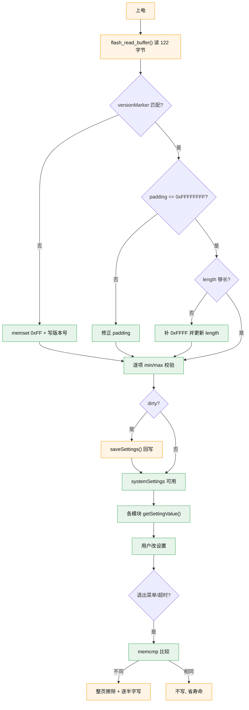
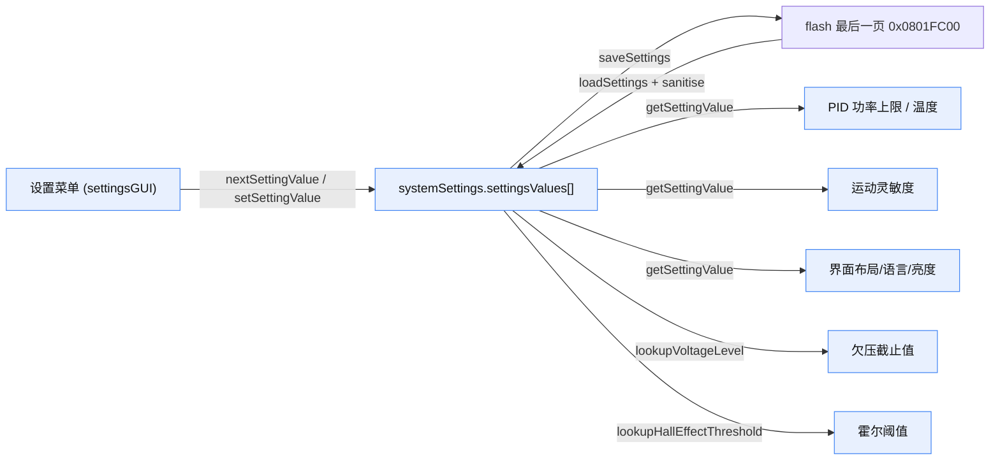

# IronOS 源码详解 05：设置系统与持久化

> 涉及文件：
> `source/Core/Inc/Settings.h`、`source/Core/Src/Settings.cpp`、
> `source/Core/BSP/Pinecil/configuration.h`、`source/Core/BSP/Pinecil/flash.c`、
> `source/Core/Src/settingsGUI.cpp`、`source/Settings/settings.yaml`（生成源）

设置系统看起来只是"一个数组加读写 flash"，但它同时承担了三件事：
**跨版本兼容**、**取值合法性**、**有限擦写寿命下的可靠存储**。这三件事决定了它的所有设计。

## 数据结构

```cpp
typedef struct {
  uint16_t versionMarker;
  uint16_t length; // Length of valid bytes following
  uint16_t settingsValues[SettingsOptionsLength];
  // used to make this nicely "good enough" aligned to 32 bytes to make driver code trivial
  uint32_t padding;

} systemSettingsType;
```

（`source/Core/Inc/Settings.h:113-120`）

大小计算：

```
2 (versionMarker) + 2 (length) + 57*2 (settingsValues) + 4 (padding) = 122 字节
122 / 2 = 61 个 uint16 —— 可以被半字编程（halfword program）整除
```

注释里说"对齐到 32 字节"，实际是让结构体尾部落在 4 字节边界、总长为偶数，
方便 STM32/GD32 的 `fmc_halfword_program` 逐半字写入。**不要**为了"更好看"去改
`padding` 的类型或顺序，`sizeof` 变化会直接破坏已出厂设备的设置区。

`SettingsOptions` 的枚举值就是数组下标：

```cpp
enum SettingsOptions {
  SolderingTemp                  = 0,  // current set point for the iron
  SleepTemp                      = 1,  // temp to drop to in sleep
  SleepTime                      = 2,  // minutes timeout to sleep
```

（`source/Core/Inc/Settings.h:39-41`）

```cpp
  SettingsOptionsLength = 57, // End marker
```

（`source/Core/Inc/Settings.h:98`）

**新增设置项只能追加在 57 之前**，因为：

1. 下标同时是 `settingsValues[]` 的下标；
2. 下标也是翻译表 `SettingsDescriptions[]` / `SettingsShortNames[]` 的下标；
3. 老设备 flash 里存的是旧布局，插队会让所有后续项错位。

## 三个版本相关的常量

```c
#define SETTINGSVERSION (0x55AB) // This number is frozen, do not edit
```

（`source/Core/Inc/Settings.h:34`，Pinecil V2 分支；其它机型为 `0x55AA`）

| 常量 | 位置 | 作用 |
| --- | --- | --- |
| `SETTINGSVERSION` | `Settings.h:34/36` | 结构布局版本；不匹配则整块重置 |
| `SETTINGS_START_PAGE` | `configuration.h:176` | 设置区起始地址 |
| `SettingsOptionsLength` | `Settings.h:98` | 有效项数，用于向前兼容 |

`SETTINGS_START_PAGE` 的取值：

```c
#define SETTINGS_START_PAGE (0x08000000 + (127 * 1024))
```

（`source/Core/BSP/Pinecil/configuration.h:176`）

即 `0x0801FC00`——128 KB flash 的最后一页（GD32VF103 的页大小 1 KB）。
把设置放在最后一页是常见做法：升级固件时只擦写前面的区域，设置不会丢。

## 上电加载：sanitise 的三道校验

```cpp
bool sanitiseSettings() {
  // For all settings, need to ensure settings are in a valid range
  // First for any not know about due to array growth, reset them and update the length value
  bool dirty = false;
  if (systemSettings.versionMarker != SETTINGSVERSION) {
    memset((void *)&systemSettings, 0xFF, sizeof(systemSettings));
    systemSettings.versionMarker = SETTINGSVERSION;
    dirty                        = true;
  }
```

（`source/Core/Src/Settings.cpp:109-116`）

1. **版本号**：不匹配 → 整块填 `0xFF`（模拟"已擦除"状态），写入新版本号。
   后续的 min/max 校验会把 `0xFFFF` 全部替换成默认值。
2. **padding**：必须是 `0xFFFFFFFF`，否则改写。这样"回滚到旧固件"时旧固件看到的
   也是"已擦除"的 padding，不会误判。
3. **长度**：`length < SettingsOptionsLength` 时，把新增的项填 `0xFFFF` 并更新长度。
   这是**向前兼容**的关键：老固件写入的 length 较小，新固件补默认值。

最后逐项校验：

```cpp
  for (int i = 0; i < (int)SettingsOptions::SettingsOptionsLength; i++) {
    // Check min max for all settings, if outside the range, move to default
    if (systemSettings.settingsValues[i] < settingsConstants[i].min || systemSettings.settingsValues[i] > settingsConstants[i].max) {
      systemSettings.settingsValues[i] = settingsConstants[i].defaultValue;
      dirty                            = true;
    }
  }
```

（`source/Core/Src/Settings.cpp:129-135`）

这一步能救回很多"刷机刷到一半断电"的设备：flash 里可能是半写状态，
随机值几乎必然落在合法范围之外。

`settingsConstants[]` 不在本文件里，而是由 `source/Settings/settings.yaml`
经 `generate_settings.py` 生成的表（C 级生成物，勿手改）。每个设置项的
min/max/increment/default 都在 yaml 里声明，生成器负责生成 C 数组。

## 保存：先比较，再擦写

```cpp
void saveSettings() {
#ifdef CANT_DIRECT_READ_SETTINGS
  // For these devices flash is not 1:1 mapped, so need to read into staging buffer
  systemSettingsType settings;
  flash_read_buffer((uint8_t *)&settings, sizeof(systemSettingsType));
  if (memcmp((void *)&settings, (void *)&systemSettings, sizeof(systemSettingsType))) {
    flash_save_buffer((uint8_t *)&systemSettings, sizeof(systemSettingsType));
  }
```

（`source/Core/Src/Settings.cpp:82-88`）

两点设计：

1. **`memcmp` 提前退出**：内容没变就不擦写。flash 页的擦写寿命约 10 万次，
   而用户可能每次调温都触发保存，这个比较能把写入次数降低一个数量级。
2. **`CANT_DIRECT_READ_SETTINGS`**：Pinecil 的 flash 不能像 STM32 那样
   直接按地址读（GD32VF103 的 flash 读取需要走 FMC 控制器），所以先读进
   staging buffer 再比较。

实际擦写由 BSP 完成：

```c
void flash_save_buffer(const uint8_t *buffer, const uint16_t length) {
  ...
  fmc_page_erase((uint32_t)SETTINGS_START_PAGE);
  ...
    fmc_halfword_program((uint32_t)SETTINGS_START_PAGE + (i * 2), data[i]);
```

（`source/Core/BSP/Pinecil/flash.c:14-28`）

注意：**整页擦除 + 逐半字写**，中途断电会丢失全部设置。这就是为什么
`sanitiseSettings()` 必须在每次上电都跑一遍。

## 什么时候保存

| 触发点 | 代码位置 | 说明 |
| --- | --- | --- |
| 退出设置菜单 | `SettingsMenu.cpp` 的 `BUTTON_BOTH` 分支 | 只在离开菜单时写一次 |
| 调温界面退出/超时 | `TemperatureAdjust.cpp` | 3 s 无操作或双键退出 |
| 校准完成 | `CJC.cpp`、`settingsGUI.cpp` 的 `setCalibrateVIN` | 校准值必须立刻落盘 |
| 告警计数器递增 | `ShowStartupWarnings.cpp` | 避免每次上电重复弹窗 |
| 设置被重置 | `sanitiseSettings()` | 把默认值写回去 |

这种"批量保存"策略是刻意的：如果每按一次键就写 flash，一天调温几十次，
一年就是上万次擦写，很快会磨穿。



## 读取与步进

```cpp
uint16_t getSettingValue(const enum SettingsOptions option) { return systemSettings.settingsValues[(int)option]; }
```

（`source/Core/Src/Settings.cpp:162`）

读取是**无边界检查**的数组访问。这是性能考量（每帧要读十几次），
代价是传入非法枚举会读到相邻字段。所有调用方都用编译期枚举，风险可控。

步进逻辑（`nextSettingValue`）处理三种情况：

```
当前 == max          → 回绕到 min
当前 >= max - step   → 夹到 max（保证能精确停在最大值）
否则                 → 加 step
```

`isLastSettingValue()` 还额外处理了温度单位的差异：设置项里存的是用户单位，
但 `SolderingTemp` 的合法上限在 C/F 下不同（450 C / 850 F），
所以判断"是否最后一项"时必须先看 `TemperatureInF`。

## 派生量：设置值 → 物理量

设置项本身是"用户语义"的（例如"3 串电池"），真正参与控制的是物理量。
转换集中在两个 lookup 函数：

```cpp
uint8_t lookupVoltageLevel() {
  auto minVoltageOnCell    = getSettingValue(SettingsOptions::MinDCVoltageCells);
  auto minVoltageCellCount = getSettingValue(SettingsOptions::MinVoltageCells);
  if (minVoltageOnCell == 0) {
    return 90; // 9V since iron does not function effectively below this
  } else {
    return (minVoltageOnCell * minVoltageCellCount) + (minVoltageCellCount * 2);
  }
}
```

（`source/Core/Src/Settings.cpp:260-268`）

公式的含义：每节电池的截止电压（0.1 V 单位）+ 每节 0.2 V 的线损补偿。
例如 3 串、每节 3.0 V：`3*30 + 3*2 = 96`，即 9.6 V 截止。

`lookupHallEffectThreshold()` 则是一张近似指数的查找表（1000/750/500/250/150/100/75/50/25），
档位越高阈值越低（越灵敏）。



## 量化：一次保存的代价

- 擦除：1 KB 页，GD32 典型擦除时间 ~20 ms（手册量级），期间 CPU 取指会停顿；
- 写入：61 个半字，每个约 50 µs，合计 ~3 ms；
- 合计 **20~30 ms 的阻塞**，发生在退出菜单的瞬间。

这解释了为什么"退出设置菜单"会有一瞬间的卡顿——GUI 任务在 `saveSettings()` 里
被 flash 操作阻塞了整整一帧以上。如果此时 PID 正在加热，控制环不受影响（不同任务），
但屏幕会停一下。

## 陷阱与实测建议

- **不要频繁调用 `saveSettings()`**：每次都是一次页擦除。调试时如果发现某个功能
  让设置区寿命骤降，先查调用点。
- **改结构体布局必须同时改 `SETTINGSVERSION`**，否则老设备升级后会读到错位数据。
- **`SettingsOptionsLength` 只能增大**。减小会让老设备多出的项被忽略，但新设备
  写回的 length 变短后，再刷回老固件会触发"补默认值"，设置丢失。
- **多语言字符串的索引也是设置下标**：新增设置项时忘了加翻译，
  `SettingsDescriptions[i]` 会越界读到别的字符串，表现为菜单里出现乱码或空白。
- 用 `source/Settings/edit_settings.py` 可以离线编辑 `settings.yaml`，
  但生成物（`settings_gen.cpp`）不要手改——下次构建会被覆盖。

## 相关 KB 条目

- [settings_persistence.md](../../../05-学习笔记与知识库/Knowledge-Base/ironos/settings_persistence.md)
- [settings_gui.md](../../../05-学习笔记与知识库/Knowledge-Base/ironos/settings_gui.md)
- [settings_menu.md](../../../05-学习笔记与知识库/Knowledge-Base/ironos/settings_menu.md)
