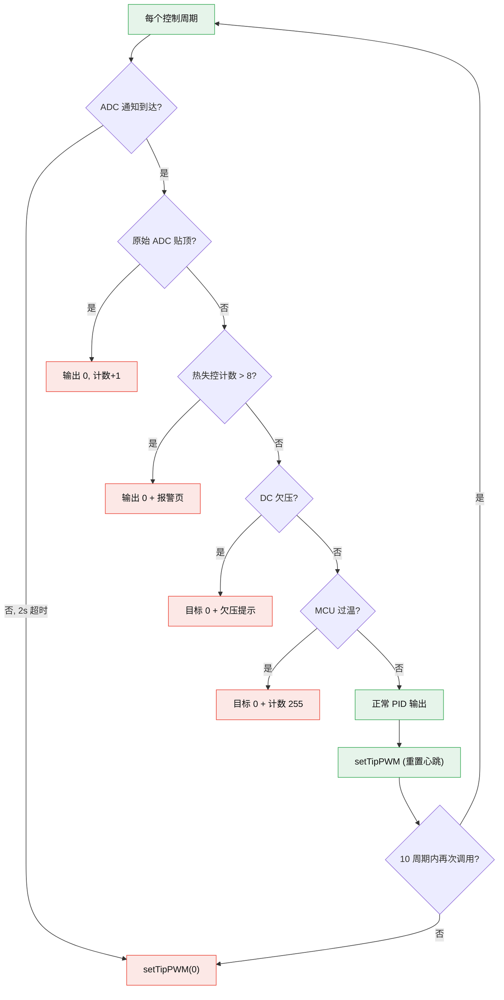
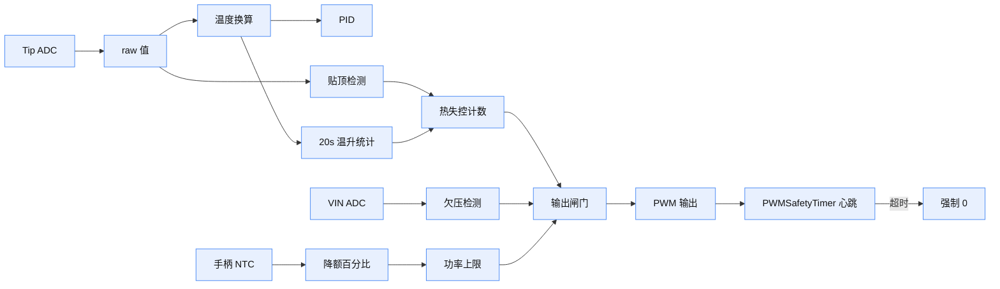

# IronOS 源码详解 06：安全保护机制

> 涉及文件：
> `source/Core/Threads/PIDThread.cpp`、`source/Core/BSP/Pinecil/IRQ.cpp`、
> `source/Core/Threads/UI/logic/utils/checkUndervoltage.cpp`、
> `source/Core/BSP/Pinecil/BSP.cpp`、`source/Core/BSP/Pinecil/Setup.cpp`、
> `source/Core/Src/FreeRTOSHooks.c`、`source/Core/Src/Settings.cpp`、
> `source/Core/Threads/UI/logic/ShowStartupWarnings.cpp`

一根 300 °C 的烙铁如果失控，几分钟内就能烧穿桌面甚至起火。IronOS 的保护不是
一个"安全模块"，而是**散布在控制链每一层的十道闸门**，任何一道失效，下一道仍然有效。

## 保护层次总览

| # | 保护 | 检测量 | 阈值 | 动作 | 代码 |
| --- | --- | --- | --- | --- | --- |
| 1 | PWM 心跳 | `PWMSafetyTimer` | 10 个 PWM 周期 | 硬件停止输出 | `IRQ.cpp` |
| 2 | ADC 超时 | 通知等待 | 2 s | `setTipPWM(0)` | `PIDThread.cpp` |
| 3 | ADC 贴顶 | `getTipRawTemp()` | `0x7FFF-32` | 立即输出 0 | `PIDThread.cpp` |
| 4 | 热失控计数 | `heaterThermalRunawayCounter` | > 8 | 输出 0 + 报警页面 | `PIDThread.cpp`/`Soldering.cpp` |
| 5 | 加热无温升 | 20 s 内 min/max 差 | < 3 °C | 计数 +1 | `detectThermalRunaway` |
| 6 | 欠压 | `getInputVoltageX10()` | `lookupVoltageLevel()` | 退出焊接模式 | `checkUndervoltage.cpp` |
| 7 | 烙铁头未接 | 温度贴近满量程 | `max-5 °C` | 禁止进入焊接 | `BSP.cpp` |
| 8 | MCU 过温 | 内部温度传感器 | `MCU_TEMP_CUTOFF_C` | 目标 0 + 计数 255 | `PIDThread.cpp` |
| 9 | 手柄降额 | 手柄 NTC | `HANDLE_DERATE_*` | 线性降功率 | `getX10WattageLimits` |
| 10 | 硬件额定 | 常量 | `HARDWARE_MAX_WATTAGE_X10` | 夹住功率上限 | `getX10WattageLimits` |
| 11 | 看门狗 | IWDG | 溢出 | 整机复位 | `FreeRTOSHooks.c` |
| 12 | 设置损坏 | 版本/范围 | — | 恢复默认值 | `sanitiseSettings` |
| 13 | 栈溢出 | FreeRTOS 钩子 | — | `reboot()` | `FreeRTOSHooks.c` |

## 第一道：PWM 心跳（硬件级）

```cpp
void setTipPWM(const uint8_t pulse, const bool shouldUseFastModePWM) {
  // 10 个周期 ≈ 10~20 ms 的容忍窗口：PID 正常 8 Hz 调用，余量充足；
  // 一旦任务被长时间阻塞（例如 I2C 卡死），输出会在 ~20 ms 内自动归零。
  PWMSafetyTimer = 10; // This is decremented in the handler for PWM so that the tip pwm is
                       // disabled if the PID task is not scheduled often enough.
```

（`source/Core/BSP/Pinecil/IRQ.cpp:133-137`）

定时器中断里：

```cpp
    // 安全计数为 0 时不再更新占空，且保持输出关闭：这是"PID 停转"的兜底。
    // 只有 setTipPWM 重新置 10，输出才会恢复。
    if (PWMSafetyTimer) {
      PWMSafetyTimer--;
```

（`source/Core/BSP/Pinecil/IRQ.cpp:68-71`）

这是**最可靠的一道**：它不依赖任何任务、任何软件状态机，只依赖定时器中断。
即使 PID 任务被高优先级中断永久抢占、I2C 死锁、甚至任务被删除，
10 个 PWM 周期后输出也会归零。周期约 1~2 ms，所以最坏情况 20 ms 内断电。

注意：`PWMSafetyTimer` 为 0 时，`pendingPWM` 不会被写入 TIMER1，且 TIMER2 输出保持 0。
恢复的唯一方式是重新调用 `setTipPWM()`。

## 第二道：ADC 超时

```cpp
    } else {
      // ADC interrupt timeout
      // 拿不到新温度就绝不允许继续加热：宁可掉温，也不能用陈旧读数闭环。
      setTipPWM(0, false);
    }
```

（`source/Core/Threads/PIDThread.cpp:158-161`）

`ulTaskNotifyTake(pdTRUE, 2 秒)` 超时说明 ADC 中断停了（定时器被关、ADC 配置丢失、
或中断优先级被改坏）。这时**不能用上一次的温度继续闭环**——烙铁可能正在持续加热，
而读数已经停在旧值上。

## 第三、四、五道：热失控

```cpp
  if (!thisCycleIsHeating && (getTipRawTemp(0) > (ADC_MAX_READING - 8)) && heaterThermalRunawayCounter < 255) {
    heaterThermalRunawayCounter++;
  }
```

（`source/Core/Threads/PIDThread.cpp:364-366`）

三条判据汇总到同一个计数器：

| 判据 | 物理故障 | 触发条件 |
| --- | --- | --- |
| 关断时 ADC 贴顶 | MOSFET 击穿/短路 | `raw > 32768-8` 且未加热 |
| 加热 20 s 温升 < 3 °C | 热电偶断路、运放饱和 | `max-min < 3` |
| MCU 过温 | 输出级过热 | `getMCUTemperatureC() > MCU_TEMP_CUTOFF_C` |

计数器在 PID 主循环里每秒衰减 1：

```cpp
    // 热失控计数每秒衰减 1：必须"持续异常"才能累积到触发阈值（>8，见过滤函数）。
    if (xTaskGetTickCount() - lastThermalRunawayDecay > TICKS_SECOND) {
```

（`source/Core/Threads/PIDThread.cpp:166-167`）

输出前的硬切断：

```cpp
  // 计数 >8 才真正切断：单次异常（例如拔插烙铁头造成的瞬时贴顶）不会误关机，
  // 连续 9 秒以上的异常才判定为热失控。
  if (heaterThermalRunawayCounter > 8) {
    x10WattsOut = 0;
  }
```

（`source/Core/Threads/PIDThread.cpp:476-479`）

**为什么是 9 秒而不是立即切断？** 拔插烙铁头时 ADC 会瞬间贴顶 1~2 秒，
如果立即关机，用户每次换头都要重新开机。9 秒的窗口既能滤掉这种瞬态，
又能在真正的 MOSFET 击穿时及时断电（9 秒 × 满功率 50 W = 450 J，不足以烧毁，
但足以让用户察觉异常）。

## 第六道：欠压保护

```cpp
  if (xTaskGetTickCount() > (TICKS_SECOND * 2)) {
    if ((v < lookupVoltageLevel())) {
      currentTempTargetDegC = 0;
      ui_draw_warning_undervoltage();
      return true;
    }
  }
```

（`source/Core/Threads/UI/logic/utils/checkUndervoltage.cpp:16-21`）

两个前提：

1. **仅 DC 输入**：`if (!getIsPoweredByDCIN()) return false;` 放在函数开头。
   PD/QC 的电压由协议保证，不需要也不应该用电池截止电压去判断。
2. **上电 2 秒后才检查**：ADC 的 DMA 缓冲需要时间填满，前 2 秒的读数是 0 或垃圾值。

PID 任务里还有一道更早的防线（`PIDThread.cpp:104-106`）：目标温度 > 0 且 DC 输入
且电压低于截止值 → 目标置 0。它比 UI 的检查更早生效，因为 UI 要等 2 s 稳定期。

## 第七道：烙铁头未接

```cpp
bool isTipDisconnected() {

  uint16_t tipDisconnectedThres = TipThermoModel::getTipMaxInC() - 5;
  uint32_t tipTemp              = TipThermoModel::getTipInC();
  return tipTemp > tipDisconnectedThres;
}
```

（`source/Core/BSP/Pinecil/BSP.cpp:84-89`）

烙铁头未接时，运放输入悬空/饱和，ADC 读到接近满量程，换算出的温度会贴着
`getTipMaxInC()`。用"距满量程 5 °C 以内"作为判据。

它被用在两处：

- `HomeScreen.cpp`：未接烙铁头时，前键短按**不进入**焊接模式；
- `CJC.cpp`：校准前检查，未接则跳过校准（否则会把饱和值写成偏置）。

## 第八道：MCU 过温（部分机型）

```cpp
      // Last line of defence for the output stage: if the MCU die gets this hot, stop heating and raise the
      // thermal runaway warning (the handle NTC derate should have kicked in long before this)
      if (getMCUTemperatureC() > MCU_TEMP_CUTOFF_C) {
        PIDTempTarget               = 0;
        heaterThermalRunawayCounter = 255;
      }
```

（`source/Core/Threads/PIDThread.cpp:132-136`）

这是"最后一层"：正常情况下手柄 NTC 的降额（第九道）会在 MCU 过热之前就把功率压下来。
一旦真的触发，直接把计数器置 255，让后续所有保护同时生效。

## 第九、十道：功率降额

```cpp
  // Linear ramp from 100% at HANDLE_DERATE_START_C down to HANDLE_DERATE_MIN_PERCENT at HANDLE_DERATE_END_C.
  {
    const int32_t handleC = getHandleTemperature(0) / 10;
    if (handleC > HANDLE_DERATE_START_C) {
      int32_t percent = 100 - (((handleC - HANDLE_DERATE_START_C) * (100 - HANDLE_DERATE_MIN_PERCENT)) / (HANDLE_DERATE_END_C - HANDLE_DERATE_START_C));
```

（`source/Core/Threads/PIDThread.cpp:426-430`）

线性降额公式：

```
percent = 100 - (handleC - START) * (100 - MIN_PERCENT) / (END - START)
```

例如 `START=50`、`END=80`、`MIN_PERCENT=40`，手柄 65 °C 时：
`100 - 15*60/30 = 70%`，即功率上限打七折。手柄 NTC 贴在 MOSFET 附近，
测的是"手柄内部温度"，不是烙铁头温度。

硬件额定限制：

```cpp
#ifdef ENFORCE_HARDWARE_MAX_WATTAGE
  // Never exceed what the output stage is rated for, even on DC input where there is no supply limit
  if (limit > HARDWARE_MAX_WATTAGE_X10) {
    limit = HARDWARE_MAX_WATTAGE_X10;
  }
#endif
```

（`source/Core/Threads/PIDThread.cpp:418-423`）

Pinecil 的 `HARDWARE_MAX_WATTAGE_X10 = 750`（75 W）。即使 24 V 电源 + 6 Ω 烙铁头
理论上能到 96 W，输出级也只允许 75 W。

## 第十一道：看门狗

```c
void vApplicationIdleHook(void) { resetWatchdog(); }
```

（`source/Core/Src/FreeRTOSHooks.c:27`）

看门狗在**空闲任务**里喂。这个设计的巧妙之处：它检查的不是"某个任务是否运行"，
而是"系统是否还有空闲时间"。任何任务死循环且优先级高于 Idle，都会让空闲任务
得不到执行，看门狗溢出复位。

配置在 `Setup.cpp` 的 `setup_iwdg()`：

```c
  fwdgt_config(0x0FFF, FWDGT_PSC_DIV256);
  fwdgt_enable();
```

（`source/Core/BSP/Pinecil/Setup.cpp` 的 `setup_iwdg`）

`0x0FFF` 是重装值，配合 256 分频，溢出时间在秒级——足够覆盖 flash 擦除（20~30 ms）
与 I2C 长传输，又不会让真正的死锁拖太久。

## 第十二、十三道：软件完整性

| 保护 | 触发 | 行为 |
| --- | --- | --- |
| 设置损坏 | 版本不匹配 / 越界 | 恢复默认值并回写（`sanitiseSettings`） |
| 栈溢出 | FreeRTOS 检测到栈指针越界 | `reboot()` |
| 加速度计缺失 | 启动探测失败 | 关闭休眠并提示（最多 2 次） |
| PD 芯片缺失 | `fusbPresent()` 为假 | 提示并退到 QC/DC（最多 2 次） |

```c
void vApplicationStackOverflowHook(TaskHandle_t xTask, char *pcTaskName) {
  (void)xTask;
  (void)pcTaskName;

  // We dont have a good way to handle a stack overflow at this point in time
  reboot();
}
```

（`source/Core/Src/FreeRTOSHooks.c:40-46`）

栈溢出无法安全恢复（栈已经踩坏了其他内存），直接复位是唯一合理选择。

## 故障矩阵：现象 → 最可能的层

| 现象 | 优先怀疑 | 验证方法 |
| --- | --- | --- |
| 完全不加热，屏幕正常 | 第 1/2 道（PWM 心跳/ADC 超时） | 看 `heaterThermalRunawayCounter`、示波器看 TIMER2 |
| 加热几秒后断，反复 | 第 3/4 道（贴顶/热失控） | 读 `getTipRawTemp()` 是否接近 32768 |
| 显示温度正常但不化锡 | 第 6 道（欠压）或 PD 只给 5 V | USB 表看 VBUS |
| 进不了焊接模式 | 第 7 道（烙铁头未接） | 换一支烙铁头 |
| 大功率加热一分钟后降功率 | 第 9 道（手柄降额） | 摸手柄是否烫、读 NTC |
| 随机重启 | 第 11/13 道（看门狗/栈溢出） | 查是否有任务死循环、看栈水位 |
| 设置每次上电都恢复默认 | 第 12 道（flash 写失败/版本不符） | 读回 `versionMarker` |





## 陷阱与实测建议

- **不要为了"让烙铁更快"而关掉 `PWMSafetyTimer`**：它是唯一不依赖 RTOS 的保护，
  关掉之后任何一次任务卡死都会变成持续满功率加热。
- **热失控计数是"每秒衰减 1"而不是"每次循环"**：改控制频率不会改变 9 秒窗口，
  但会让计数器的增量速率变化（高频时每秒加得更多）。
- **`isTipDisconnected()` 在烙铁头很热时可能误判**：温度接近 `getTipMaxInC()`
  时会被当成"未接"。这是有意的保守策略——宁可不让用户开始焊接，也不能带着
  失效的测温链路满功率加热。
- 实测保护功能时，**先用可调直流电源限流**，不要用大功率充电器直接试；
  MOSFET 击穿是真实会发生的故障模式。
- 若设备"随机重启"，先接调试器看 `vApplicationStackOverflowHook` 是否被命中，
  再看 IWDG 是否溢出（GD32 的 `FWDGT_STAT` 有复位标志）。

## 相关 KB 条目

- [pid_thread.md](../../../05-学习笔记与知识库/Knowledge-Base/ironos/pid_thread.md)
- [bsp_pinecil_irq.md](../../../05-学习笔记与知识库/Knowledge-Base/ironos/bsp_pinecil_irq.md)
- [ui_operating_modes.md](../../../05-学习笔记与知识库/Knowledge-Base/ironos/ui_operating_modes.md)
