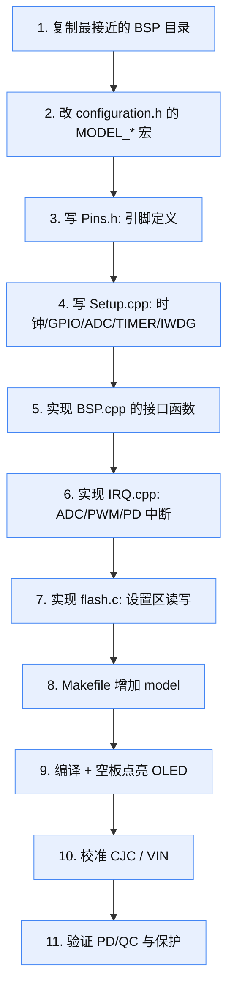
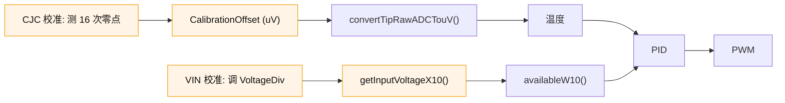
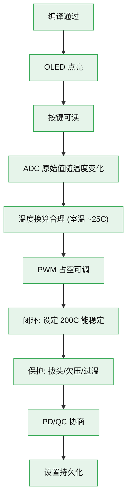

# IronOS 源码详解 07：移植与实测指南

> 涉及文件：
> `source/Core/BSP/BSP.h`、`source/Core/BSP/Pinecil/`（全套）、
> `source/Core/BSP/Pinecilv2/`、`source/Core/BSP/Miniware/`、
> `Makefile`、`source/Core/BSP/Pinecil/flash.c`、`source/Core/BSP/Pinecil/Setup.cpp`

本文面向"把 IronOS 跑到一块新板子上"和"在真机上定位问题"两种场景。
所有步骤都对应仓库里已有的实现，可以拿 Pinecil 作为参照抄。

## 一、BSP 契约：一块板必须提供什么

`source/Core/BSP/BSP.h` 是唯一需要实现的接口。按重要性排序：

| 类别 | 函数 | 不实现的后果 |
| --- | --- | --- |
| 启动 | `preRToSInit()` / `postRToSInit()` / `BSPInit()` | 时钟/外设未初始化，系统不跑 |
| 加热 | `setTipPWM(pulse, fast)` | 无法控温 |
| 测温 | `getTipRawTemp(refresh)` / `getHandleTemperature(sample)` | 温度恒为 0 或乱跳 |
| 电压 | `getInputVoltageX10(divisor, sample)` | 功率换算错误，可能炸管 |
| 功率模型 | `getTipResistanceX10()` / `getTipThermalMass()` / `getTipInertia()` | PID 增益错误 |
| 按键 | `getButtonA()` / `getButtonB()` | 无法操作 |
| 存储 | `flash_save_buffer()` / `flash_read_buffer()` | 设置无法保存 |
| 看门狗 | `resetWatchdog()` | 频繁复位（或永不复位） |
| 其它 | `reboot()` / `isTipDisconnected()` / `getIsPoweredByDCIN()` | 保护逻辑失效 |

```c
// Accepts a output level of 0.. to use to control the tip output PWM
void setTipPWM(const uint8_t pulse, const bool shouldUseFastModePWM);
```

（`source/Core/BSP/BSP.h:39-40`）

`setTipPWM` 的第二个参数是"快/慢模式"，不是"是否启用"。实现时必须保证
**占空在 PWM 周期边界生效**（Pinecil 的做法是只写 `pendingPWM`，在定时器 UP 中断里装载），
否则会出现窄脉冲，轻则电流尖峰，重则炸 MOSFET。

## 二、新增一块板的步骤



### 第 1 步：选一个最接近的参照

| 你的板子 | 参照目录 | 理由 |
| --- | --- | --- |
| STM32F103 + T12 | `BSP/Miniware` | TS100/TS80 同源 |
| GD32VF103 | `BSP/Pinecil` | RISC-V，定时器/ADC 结构相同 |
| BL706 | `BSP/Pinecilv2` | 16 位 ADC + BLE |
| 加热板/回流台 | `BSP/MHP30` | 有 `preStartChecks` 测电阻的逻辑 |

### 第 2 步：`configuration.h` 的必填项

以 Pinecil 为例，这一段是"板子的身份证"：

```c
#ifdef MODEL_Pinecil
#define SOLDERING_TEMP         320                       // Default soldering temp is 320.0 °C
#define VOLTAGE_DIV            467                       // 467 - Default divider from schematic
#define CALIBRATION_OFFSET     900                       // 900 - Default adc offset in uV
#define MIN_CALIBRATION_OFFSET 100                       // Min value for calibration
#define PID_POWER_LIMIT        70                        // Sets the max pwm power limit
```

（`source/Core/BSP/Pinecil/configuration.h:128-133`）

| 宏 | 含义 | 怎么定 |
| --- | --- | --- |
| `VOLTAGE_DIV` | 输入电压分压比 | `R_high/R_low`，再用 VIN 校准微调 |
| `CALIBRATION_OFFSET` | 热电偶零点偏置（uV） | 用 CJC 校准得到 |
| `TIP_RESISTANCE` | 烙铁头电阻（0.1 Ω） | 万用表实测，如 7.5 Ω → 75 |
| `TIP_THERMAL_MASS` | 热容（x10 J/°C） | 由升温曲线反推，Pinecil 取 65 |
| `OP_AMP_GAIN_STAGE` | 运放增益 | `1 + Rf/Rin` |
| `USB_PD_VMAX` | 允许的最高 PD 电压 | 由输出级耐压决定 |
| `PID_TIM_HZ` | 控制频率 | 与 PWM 周期一致 |
| `HARDWARE_MAX_WATTAGE_X10` | 输出级额定功率 | 由 MOSFET/电感决定 |

`PID_TIM_HZ` 与实际控制频率必须匹配，否则 `Integrator` 的 `rate` 参数会算错，
表现为"温度冲过设定点很多"或"永远到不了设定点"。

### 第 3~6 步：引脚、时钟、中断

`Pins.h` 定义所有 GPIO；`Setup.cpp` 里必须完成：

1. **时钟树**：系统主频、ADC 时钟、定时器时钟；
2. **ADC**：规则组（手柄 NTC/vin）+ 注入组（烙铁头温度），注入组由 TIMER TRGO 触发；
3. **TIMER1**：PWM 周期 = `powerPWM + tempMeasureTicks + holdoffTicks`；
4. **TIMER2**：输出门控，用于"比较匹配时硬件强制关断"；
5. **IWDG**：看门狗。

Pinecil 的 ADC 配置值得照抄：

```c
  // Setup that we want all 4 inserted readings to be the tip temp
  adc_channel_length_config(ADC0, ADC_INSERTED_CHANNEL, 4);
  adc_channel_length_config(ADC1, ADC_INSERTED_CHANNEL, 4);
  for (int rank = 0; rank < 4; rank++) {
    adc_inserted_channel_config(ADC0, rank, TIP_TEMP_ADC0_CHANNEL, ADC_SAMPLETIME_28POINT5);
    adc_inserted_channel_config(ADC1, rank, VIN_ADC1_CHANNEL, ADC_SAMPLETIME_28POINT5);
  }
  // Setup timer 1 channel 0 to trigger injected measurements
  adc_external_trigger_source_config(ADC0, ADC_INSERTED_CHANNEL, ADC0_1_EXTTRIG_INSERTED_T1_TRGO);
```

（`source/Core/BSP/Pinecil/Setup.cpp:214-222`）

"4 个通道都采同一个引脚"是过采样：硬件连续转换 4 次，配合 8 倍过采样得到
`4096*8` 的满量程。这样做的收益是等效分辨率提升，代价是采样窗口要够长
（`tempMeasureTicks=14`）。

### 第 8 步：Makefile 注册机型

```make
MODELS=TS100 TS80 TS80P Pinecil MHP30 Pinecilv2 S60 TS101 S60P T55 S99 # target names & dir names
```

（`Makefile:63`）

模型名必须与 `source/Core/BSP/<Model>` 目录名一致；Makefile 会用
`-DMODEL_<Model>` 传给编译器，`configuration.h` 里的 `#ifdef MODEL_Pinecil` 才生效。

## 三、校准

### 3.1 冷端补偿（CJC）

原理：热电偶两端同温时输出 0 uV。上电初期烙铁头与手柄温度接近，此时测到的
uV 就是本机的固定偏置。代码在 `Threads/UI/logic/CJC.cpp`：

```cpp
  if (!isTipDisconnected() && abs(int(TipThermoModel::getTipInC() - getHandleTemperature(0) / 10)) < 10) {
    // Take 16 samples, only sample
    if (cxt->scratch_state.state1 < 16) {
```

（`source/Core/Threads/UI/logic/CJC.cpp:14-16`）

要求：烙铁头已接、且与手柄温差 < 10 °C。采样 16 次取平均，写入
`SettingsOptions::CalibrationOffset`。

### 3.2 输入电压校准

`settingsGUI.cpp` 的 `setCalibrateVIN()` 提供一个实时读数界面：
用万用表测 VBUS，按 +/- 调 `VoltageDiv` 直到显示一致。

### 3.3 温度校准（可选）

没有独立的"温度校准"菜单，因为热电偶曲线由 `TEMP_uV_LOOKUP_HAKKO` 表固定。
如果发现 300 °C 时实际偏低，正确做法是：

1. 先做 CJC（零点）；
2. 再检查 `OP_AMP_GAIN_STAGE` 是否与原理图一致；
3. 最后才考虑换查找表（`BSP/*/ThermoModel.cpp` 的 `uVtoDegC[]`）。



## 四、常见坑（按出现频率排序）

| # | 现象 | 原因 | 解决 |
| --- | --- | --- | --- |
| 1 | 温度乱跳/恒为 0 | ADC 注入组触发源或采样时间不对 | 对照 `Setup.cpp` 的 `ADC_SAMPLETIME_28POINT5` |
| 2 | 加热时温度读数异常高 | 采样窗口落在加热期间 | 增大 `holdoffTicks`，确认 CH0 比较值 = `powerPWM+holdoff` |
| 3 | MOSFET 发热严重 | 快/慢 PWM 切换点设置不当 | 调 `fastPWMChangeoverPoint`，或加大死区 |
| 4 | PD 只给 5 V | Sink Capabilities 的电流声明过小 | 检查 `getTipResistanceX10()` 返回值 |
| 5 | 设置保存后丢失 | `flash_save_buffer` 的页地址/长度错 | 确认 `SETTINGS_START_PAGE` 在最后一页 |
| 6 | 开机就重启 | 看门狗在 `preRToSInit` 期间溢出 | 在长初始化段里插入 `resetWatchdog()` |
| 7 | OLED 花屏 | I2C 时序太快/上拉不足 | 降速或改用硬件 I2C |
| 8 | 按键无反应 | 极性反了（Pinecil 高有效） | 改 `getButtonA/B()` 的 `== SET` 判断 |
| 9 | 休眠不触发 | 加速度计探测失败 | 看 `DetectedAccelerometerVersion` 是否为 `None` |
| 10 | 功率上不去 | 手柄 NTC 降额或 PD 限流 | 读 `getX10WattageLimits()` 的四个分项 |

### 坑 2 的量化

采样窗口必须落在"加热关断 + 死区"之后：

```
CH0 比较值 = powerPWM + holdoffTicks = 255 + 10 = 265
窗口长度   = tempMeasureTicks = 14 tick
```

如果 `holdoffTicks` 太小，MOSFET 关断瞬间的 dv/dt 会通过米勒电容耦合进运放，
读数会偏高几十度。Pinecil 取 10 tick 是实测结果。

### 坑 5 的检查方法

用调试器读 `systemSettings.versionMarker`：

- 如果是 `0xFFFF`：flash 从未写成功（页地址错/写保护）；
- 如果是 `0x55AA` 但设置是默认值：每次上电都触发了 sanitise（说明写入失败或版本不匹配）。

## 五、实测清单

上电前：

- [ ] 用限流电源（1 A）首次上电，确认没有短路；
- [ ] 测 3.3 V 轨与 ADC 基准；
- [ ] 确认 MOSFET 栅极有下拉电阻（防止复位期间误导通）。

上电后：

- [ ] OLED 能亮，能看到启动 logo；
- [ ] 进设置菜单能改语言/亮度（验证 flash 写入）；
- [ ] 用示波器看 TIMER2 输出：占空应随设定温度变化；
- [ ] 烙铁头温度用热电偶表对比，误差 < 15 °C；
- [ ] 拔掉烙铁头，界面应提示"未接"；
- [ ] 调低输入电压到截止值以下，应退出焊接模式；
- [ ] 长按双键能锁定/解锁按键。

压力测试：

- [ ] 连续满功率 10 分钟，手柄温度不应触发降额（或触发后能恢复）；
- [ ] 快速反复插拔 PD 电源，协商应能恢复；
- [ ] 设置菜单里反复进出，确认不会卡死（验证 `saveSettings` 的阻塞时间）。

## 六、移植时的最小验证顺序



**不要跳步**。最常见的翻车方式是"直接烧录完整固件然后满功率试加热"——
如果 ADC 通道映射错了，PID 会以为温度是 0，直接输出 100% 占空，几十秒内就能
把烙铁头烧红甚至烧断。

## 陷阱与实测建议

- **`getTipResistanceX10()` 返回 0 表示"自动"**，不是"电阻为 0"：

```cpp
uint8_t getTipResistanceX10() {
  uint8_t user_selected_tip = getUserSelectedTipResistance();
  if (user_selected_tip == 0) {
    return TIP_RESISTANCE; // Auto mode
  }
  return user_selected_tip;
}
```

（`source/Core/BSP/Pinecil/BSP.cpp:97-103`）

- **Pinecil V2 的 ADC 是 16 位取半**（`(1<<16)>>1`），与 V1 的 `4096*8` 数值相同
  但含义不同；移植时不要直接抄常量，要理解"满量程"的定义。
- **PD 协商需要 VBUS 先稳定**：如果 `start()` 在 VBUS 建立前调用，FUSB302 会读不到 ID，
  固件会认为"没有 PD 芯片"，从此只走 QC。
- **手柄 NTC 的降额曲线是线性插值**，`HANDLE_DERATE_START_C` 设得太低会让正常使用
  就降功率；Pinecil 的默认值来自实测手柄温升曲线，不要随意改小。
- 调试时打开 `DEBUG_UART_OUTPUT` 可以用 `log_system_state()` 输出每个周期的功率与状态，
  但会占用 UART 引脚，量产固件应关闭。

## 相关 KB 条目

- [main_startup.md](../../../05-学习笔记与知识库/Knowledge-Base/ironos/main_startup.md)
- [settings_persistence.md](../../../05-学习笔记与知识库/Knowledge-Base/ironos/settings_persistence.md)
- [bsp_pinecil_irq.md](../../../05-学习笔记与知识库/Knowledge-Base/ironos/bsp_pinecil_irq.md)
- [tip_thermo_model.md](../../../05-学习笔记与知识库/Knowledge-Base/ironos/tip_thermo_model.md)
